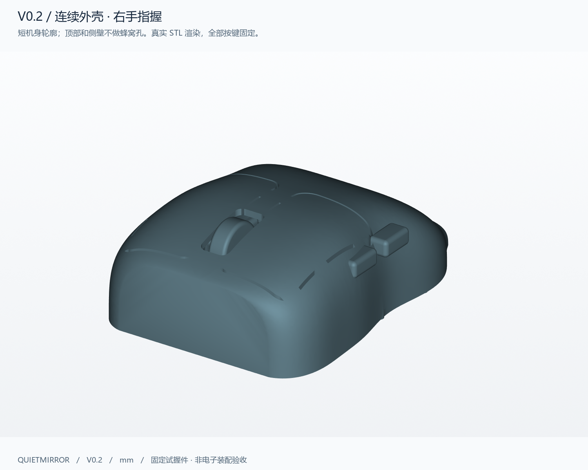
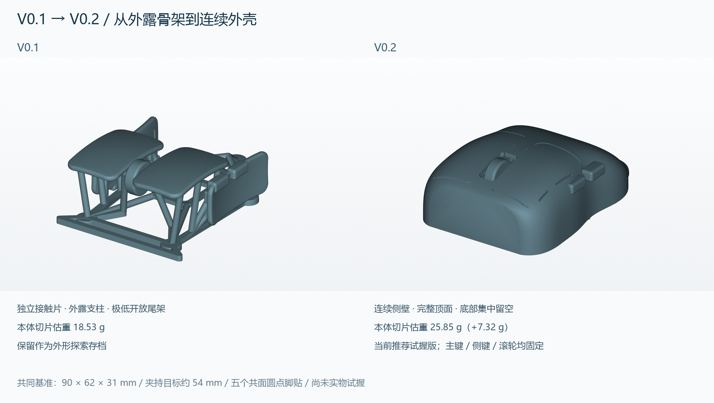
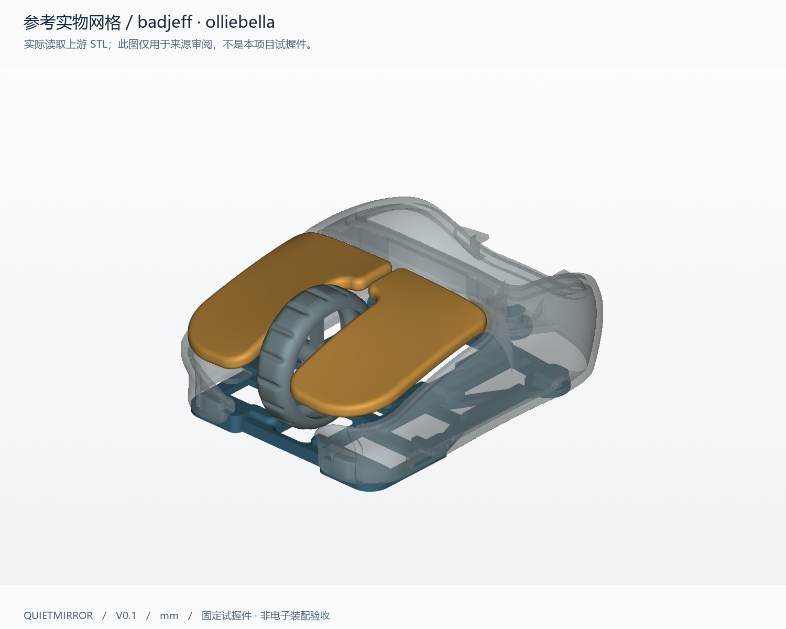
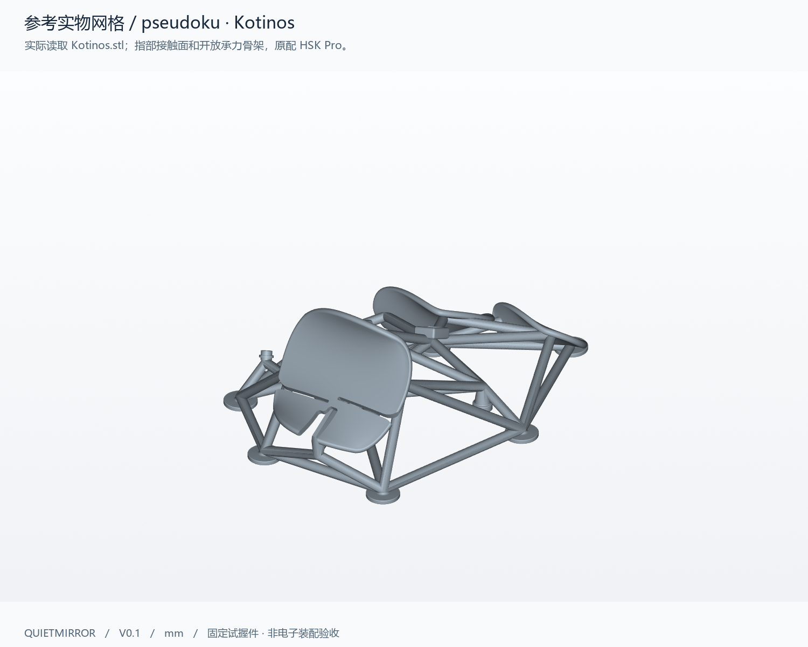

# Quietmirror · 右手指握鼠标

**当前推荐试握版：V0.2 — 连续外壳、短机身、减少外露骨架。**

这是可参数化、可 3D 打印的右手 fingertip / fingergrip 鼠标试握项目。V0.2 保留 V0.1 的五脚布局和独立触达参数，向 **G-Wolves（游狼）HSK / HTR 的紧凑短机身轮廓**靠近：顶部和侧壁保持完整，减重主要放在底部。没有使用商业鼠标 CAD，也没有扫描复刻某一型号。



**长 90 × 最大外宽约 62 × 高 31 mm；夹持中部截面约 54.04 mm。** 这些是试握假设，尚未经实物握持验证。主键、两个侧键和滚轮均固定，壳体、筋条和五个脚贴平台连接为同一个打印实体。

## 下载与详细说明

| 文件 | 用途 |
|---|---|
| **[V0.2 STL](exports/v02/quietmirror_fingertip_V0.2.stl)** | 导入切片器，按毫米、100% 比例使用 |
| **[V0.2 3MF](exports/v02/quietmirror_fingertip_V0.2_PRINT.3mf)** | 已居中、脚面朝下，内含通用 PLA 估算配置；打开后选择自己的打印机 |
| **[V0.2 STEP](exports/v02/quietmirror_fingertip_V0.2.step)** | 有效的单一 B-rep 实体，可用其他 CAD 编辑 |
| [CadQuery 源码](cad/build_v02.py) + [参数 JSON](cad/parameters_v02.json) | 参数化源文件；共用辅助函数见 [build_mouse.py](cad/build_mouse.py) |
| [电子包络 STEP](exports/v02/electronic_envelopes_V0.2_ESTIMATES.step) | 壳体与16个参考包络；不是打印文件或装配验收 |
| **[详细设计思路与验证报告](reports/v02/DESIGN.md)** | 结构取舍、实际检测数据、打印与后续迭代 |
| [电子空间与装配待测](reports/v02/ELECTRONICS.md) | 估计包络、当前干涉和必须补测的数据 |
| [试握反馈表](reports/v02/FIT_FEEDBACK.md) | 握宽、顶掌、拖地、滚轮/侧键触达、抬鼠稳定性 |

GitHub 打开 STL 可尝试 3D 预览；下载用文件页的 **Download raw file**。STEP 保留实体几何；完整参数及生成逻辑在 Python + JSON 中，不是原生 Fusion / SolidWorks 历史特征树。

## 图纸与新旧版对比

[俯视](views/v02/02_top.png) · [拇指侧](views/v02/03_left_side.png) · [底视](views/v02/04_bottom.png) · [右侧](views/v02/05_right_side.png) · [内部包络](views/v02/06_envelopes.png) · [尺寸图](views/v02/07_dimensions.png) · [包络尺寸表](views/v02/08_envelope_layout.png) · [真实切片截面](views/v02/09_slice_layers.png)



| 项目 | V0.1 | V0.2 当前版 |
|---|---|---|
| 外形方向 | 独立接触片与外露骨架 | 连续曲面外壳与内部筋条 |
| 顶部与侧面 | 接触面完整，周围大面积开放 | 无蜂窝孔；主键轮廓仅留0.65 mm窄缝，由实体桥固定 |
| 后部 | 极低开放尾架 | 完整外壳平缓下降，保留短低尾部 |
| 夹持 | 分立浅凹侧片 | 连续侧壁的浅腰线，右侧低位托边 |
| 本体 CAD 体积 | 14.704 cm³ | 20.557 cm³ |
| 本体切片估重，PLA | 18.53 g | 25.85 g |
| 含支撑、裙边用料 | 32.27 g | 44.41 g |
| 使用阶段 | 外形探索存档 | 优先打印、试握反馈 |

V0.1 完整模型、参数和报告仍保留：[V0.1 存档](README_V0.1.md)。重量均来自相同主要设置的 PrusaSlicer 2.9.6 实际切片，不含电子件、螺钉、脚贴和涂装。

## 为什么这样设计

**先让手指接触完整曲面。** 旧版解决了五脚连接和触达关系，但外露支柱使其更像测试骨架。新版将顶部、两侧和低尾部连成薄壳，使夹持力沿侧壁传到底框，接触区附近没有蜂窝孔边缘。

**借鉴游狼的短机身，同时省去孔阵。** 实际查看 HSK Pro、HTR Pro 产品图，采用紧凑轮廓、前部双主键、居中滚轮和短尾部的方向。参考产品有蜂窝孔，本项目根据“不要过分镂空”的要求主动省略。保留自己的右手侧键、右侧托边、90 × 62 × 31 mm 试握基准及五个圆点脚贴。[游狼参考记录与来源](references/GWOLVES_REFERENCE.md)

**把减重放在非接触区域。** 底部在 Z=1.2 mm 截面约73.34%留空，保留五个Ø8.8 mm平台、周向框架和通向传感器定位区的斜筋。从底部看见顶壳内面属于正常结构，并不表示底部被封成实心。

**接受首轮多一点重量，以换取可评价的外形。** V0.2 比 V0.1 本体增加约7.32 g。普通壳壁1.8 mm，底筋2.6 mm、斜筋及滚轮支撑2.8 mm；先验证握持、打印和局部刚度，再逐轮减薄。不把商业成品鼠标的整机重量直接作为 FDM 试握件指标。

手部数据仅记录“腕到中指尖约230 mm、拇指尖到小指尖张开跨度约190 mm”。**190 mm不是掌宽、握宽或鼠标外宽；没有按手长整体等比放大，没有填入虚构的指节长度。** 自然夹持位置和实物反馈优先于照片推算。

## 打印和验证

首轮建议 PLA、0.4 mm喷嘴、0.2 mm层高、4道周壁、20% gyroid、5层顶底。五个脚贴平面朝下，树状支撑仅从热床生成，重点支撑内顶壳、固定滚轮/轴、侧键凸台和托边下方。底部开口用于拆内部支撑；模型筋条不可当支撑剪掉。4 mm外裙边帮助五脚起层。

实际切片：本体**25.85 g**、支撑**18.38 g**、裙边**0.17 g**，共**44.41 g PLA**，约**5小时18分钟**。最终3MF不加载额外INI重切片得到**44.63 g / 5小时20分钟**，16项关键配置一致，两次差异如实保留。这些都是通用配置估算，尚未实物打印、去支撑或称重。[切片说明](slicing/V0.2_PRINTING.md)

已检查：有效STEP实体1个；STL连通实体1个，封闭且法线一致，自相交0，非流形边/点0；五脚45个采样点均Z=0；867个常规曲面法向壁厚采样，最小约**1.775 mm**。壁厚采样排除了窄缝边缘、端缘和侧键过渡，不代表全表面连续最薄壁证明。切片器读入 **61.984 × 90.000 × 31.000 mm（X/Y/Z）**，未发生单位放大。[原始验证数据](reports/v02/validation.json)

去支撑后轻修毛刺，粘五个同厚Ø7–7.5 mm圆点脚贴。脚贴不含在31 mm模型高度内。当前一体件不能评价真实点击力、回弹、滚轮阻尼或电子件重心。

## 电子装配边界

后续目标仍是 **PAW3950、2.4 GHz无线1000 Hz、左右主键、中键/滚轮、两个拇指侧键**。候选供体只按用户称呼记作 **“ATK 蜻蜓 A1 Plus”**；具体型号、传感器版本、PCB外形及孔位均未确认，没有擅自替换型号。

PAW3950是传感器型号，不对应统一主板尺寸；无线1K由主板、固件和匹配接收器共同实现。电子空间使用明确标记的估计包络，没有把估计孔位画成装配孔。新版低尾壳与当前电池包络明显干涉，主板后端、编码器和侧键板也需重新布局。**不能将此STL直接当成供体替换壳。**

传感器光轴沿Z，垂直鼠标垫。镜头高度须由真实主板基准、镜头光学基准、底面和脚贴厚度组成尺寸链确认。[16个包络、干涉和待测清单](reports/v02/ELECTRONICS.md)

## 编辑与复现

Python3.12、CadQuery2.8.0 / OpenCascade7.9.3，依赖见 [requirements.txt](requirements.txt)。在项目根目录执行：

```powershell
py -3.12 -m venv .venv
.\.venv\Scripts\python.exe -m pip install -r requirements.txt
.\.venv\Scripts\python.exe cad\build_v02.py
.\.venv\Scripts\python.exe cad\validate_v02.py
.\.venv\Scripts\python.exe cad\render_v02.py
.\.venv\Scripts\python.exe cad\make_diagrams.py --version 0.2
```

修改前复制参数；重建覆盖 `exports/v02/` 和对应报告。`--params` 可指定另一个JSON。渲染脚本用Windows微软雅黑，其他系统需替换字体路径。改几何后必须重新验证和切片。[参数说明与坐标](cad/PARAMETERS_V0.2.md)

## 开源参考与许可

实际读取了 [badjeff/olliebella](https://github.com/badjeff/olliebella) 的多个STL、[pseudoku/Kotinos](https://github.com/pseudoku/Kotinos) 的STL/SCAD、[badjeff/paw3395-pcb](https://github.com/badjeff/paw3395-pcb) 的KiCad板框和说明。具体文件、固定提交、采用的结构及未复用的孔位见 [审阅记录](references/REFERENCE_REVIEW.md)。





本项目打印几何和参数化源码为独立设计，采用 **CERN-OHL-P-2.0**，见 [LICENSE](LICENSE) 与 [NOTICE](NOTICE.md)。上游参考图保留各自作者与许可；商业G-Wolves产品图仅链接来源，不重新分发为本项目开源素材。没有并入上游STL/SCAD或商业鼠标几何。
