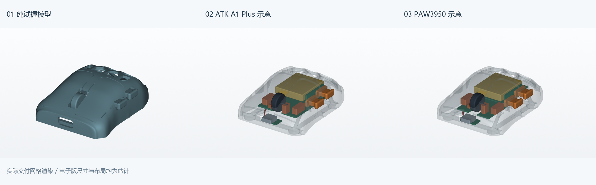
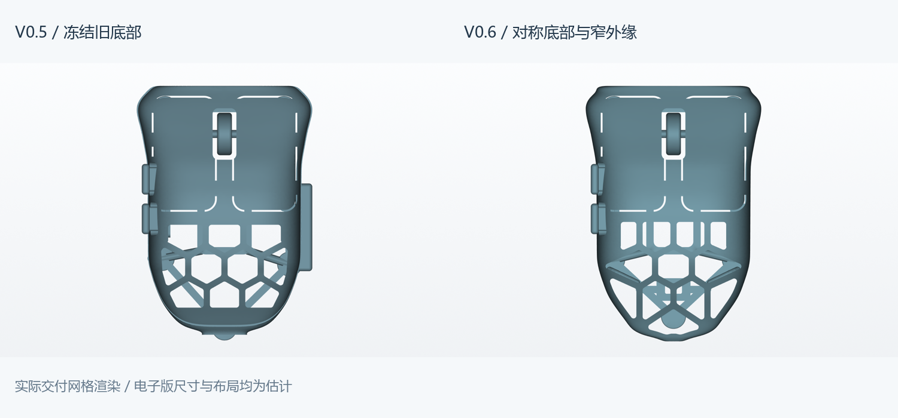

# Quietmirror · 右手指握鼠标

**当前 V0.6：除左侧双侧键及其接口外，外壳与底部沿中轴镜像；取消底部外伸托边，收窄后壳外围实面。本轮交付纯试握、ATK A1 Plus 主板示意、PAW3950 半组装主板示意三版。V0.1–V0.5 全部保留。**

[全部历史版本](HISTORY.md) · [整个项目 ZIP](https://github.com/Quietmirror/github/archive/refs/heads/main.zip) · [设计与验证](reports/v06/DESIGN.md) · **[功能、续航和电子方案详解](reports/v06/ELECTRONICS.md)**

## 三个版本下载

| 版本 | 模型 | 用途与边界 |
|---|---|---|
| **纯试握模具 FIT** | **[STL](exports/v06/quietmirror_fingertip_V0.6_FIT.stl)** · [STEP](exports/v06/quietmirror_fingertip_V0.6_FIT.step) · [打印 3MF](exports/v06/quietmirror_fingertip_V0.6_PRINT.3mf) | 单一可打印实体，主键/侧键/滚轮固定；“模具”指手握外形样件，并非注塑阴模 |
| **ATK A1 Plus 替板示意** | **[彩色装配 STEP](exports/v06/quietmirror_V0.6_ATK_A1_PLUS_ESTIMATED.step)** · [多对象观察 3MF](exports/v06/quietmirror_V0.6_ATK_A1_PLUS_ESTIMATED_VIEW_ONLY.3mf) | 用户所称供体的估计空间布局；未确认型号、传感器、实板尺寸和固件能力 |
| **PAW3950 半组装板示意** | **[彩色装配 STEP](exports/v06/quietmirror_V0.6_PAW3950_CUSTOM_ESTIMATED.step)** · [多对象观察 3MF](exports/v06/quietmirror_V0.6_PAW3950_CUSTOM_ESTIMATED_VIEW_ONLY.3mf) | 分布式主控/RF/传感器板参考布局；不是已打样或已工作的电路 |

电子场景中的主板、电池等是独立物体，**不要整场景合并打印**。配套 [ATK 净空 STEP](exports/v06/quietmirror_V0.6_ATK_A1_PLUS_ESTIMATED_CLEARANCES.step)、[PAW3950 净空 STEP](exports/v06/quietmirror_V0.6_PAW3950_CUSTOM_ESTIMATED_CLEARANCES.step) 用于检查空间。

[开侧键孔壳体 STL](exports/v06/quietmirror_fingertip_V0.6_SHELL.stl) / [STEP](exports/v06/quietmirror_fingertip_V0.6_SHELL.step) · [前侧键 STL](exports/v06/side_button_1_V0.6_PRINT.stl) / [STEP](exports/v06/side_button_1_V0.6_PRINT.step) · [后侧键 STL](exports/v06/side_button_2_V0.6_PRINT.stl) / [STEP](exports/v06/side_button_2_V0.6_PRINT.step)。独立键帽还没有真实点击/回位验证。

可编辑源：[生成器](cad/build_v06.py)、[外形参数](cad/parameters_v06.json)、[逐孔生成](cad/vent_layout_v06.py)、[电子生成器](cad/electronics_v06.py)、[电子尺寸/摆位](cad/electronics_v06.json)、[复现方法](cad/PARAMETERS_V0.6.md)。

## 外形与减重

- **外部对称**：侧键以外，包括底筋、五脚、USB-C 开口和电源开关孔均按 X=0 镜像。取消旧右侧防拖地托边，尾脚收进外壳，底筋裁齐外形投影。本轮按新要求重新设计底部，不沿用 V0.5 的 Z≤6 mm 冻结约束。
- **12 个后壳孔**，4—3—4—1 镜像排列；外缘沿壳体轮廓，孔间直筋目标 2.2 mm，外围目标 2.4 mm。22 对相邻孔最短间距约 2.2 mm；尾部两个极短分区交汇圆角节点更宽，约 5.43 mm。侧键受力区保留局部加固，不能称“每一处都等宽”。
- 后壳外轮廓 D58.5–88.5 mm 的投影采样：到最近孔的距离最小 **2.38 mm**，中位 **2.54 mm**；节点处更宽。前部按键/侧键受力区不纳入此项。
- 后肩两段较陡的窄筋增加左右镜像的 **Ø2 mm 内侧补筋**，维持外表面孔间窄筋，不靠削薄关键受力处减重。内侧补筋会进入少量孔边投影：H05/H07 的边缘网格射线有 10/9 条遇到补筋，所有孔中央净开口的贯通检查通过。指肚主接触面保持完整。
- 实际尺寸，长×宽×高：**90.312×61.970×28.002 mm**。90×62×28 mm 是名义试握参数；自由曲面末端存在离散/放样偏差，切片器按实际包围盒核对。
- 前端中轴充电孔 **13.4×6.4 mm**；底部中心开关孔 **6×3 mm**。均为估计接口，待真实连接器/开关确认。

## 已完成的验证与打印估计

FIT / SHELL / 两个独立侧键均为有效单实体，STL 封闭、单连通、法线一致，自相交面数 0。五脚 Ø8.8 mm，45 个脚底采样均在 Z=0。最终 FIT 在侧键区域之外的镜像面距离最大 **0.017 mm**，是网格离散核对，不是假定全体都对称。

常规壳面 **820** 个法向样本，最薄 **1.723 mm**；窄筋另取 **72** 个样本，最薄 **1.843 mm**。有限采样不等于连续最薄壁或强度认证；FIT 侧键固定桥仍有局部 1.2 mm 特征。CAD 体积 **17.014 cm³**，STL 体积 **17.003 cm³**。

0.4 mm 喷嘴、0.2 mm 层高、4 壁、20% gyroid、PLA 1.24 g/cm³，五脚朝下、仅热床贴合支撑、4 mm 裙边：**本体 21.421 g，支撑 14.994 g，总耗材 36.59 g，约 4h 18m 38s**。最终 3MF 不加载外部 INI 重切片，16 项设置一致；未实物打印、称重或夹持强度测试。详见 [打印说明](slicing/V0.6_PRINTING.md)、[网格/壁厚数据](reports/v06/validation.json)、[对称/孔/筋/底部检查](reports/v06/geometry_checks.json)。

## 电子目标与建议

两种方案都以 **400–6400 DPI、无线 1K、低延迟、宏、LOD、左右键/滚轮中键/双侧键、电源开关与 USB-C 充电**为验收目标；Motion Sync 等可选同步增强关闭。供体若不支持这些配置，单纯换壳不能补齐。未确认 ATK A1 Plus 的传感器，更没有假定它使用 PAW3950。

≥12 h 持续满性能的预算为：500 mAh ×75%÷30 mA = **12.5 h**。500 mAh 的容量与 26×30×6 mm 包络都是估计；需要真实电池、满性能持续电流和实际续航测试，**不是已达标承诺**。全部功能矩阵、镜头尺寸链、充电架构及待测清单见 [详细电子说明](reports/v06/ELECTRONICS.md)，干涉结果见 [装配检查](reports/v06/ASSEMBLY_CHECKS.md)。

**推荐下一步用 FreeCAD 继续真实装配**：导入 STEP，放入实测 PCB/镜头/电池，建立固定、行程和间隙。JSON/Python 仍保留外壳参数；STEP 不自动携带完整参数历史。本轮未安装建模软件，已提供交换模型。

[斜视](views/v06/01_isometric.png) · [俯视](views/v06/02_top.png) · [左侧](views/v06/03_left_side.png) · [右侧](views/v06/05_right_side.png) · [底视](views/v06/04_bottom.png) · [充电口](views/v06/06_front_charge.png) · [孔形图](views/v06/12_vent_layout.png) · [ATK 内部](views/v06/07_isometric.png) · [PAW3950 内部](views/v06/08_isometric.png) · [试握反馈](reports/v06/FIT_FEEDBACK.md)

## 来源与历史

原创代码与几何采用 [CERN-OHL-P-2.0](LICENSE)。[开源文件审阅与借鉴](references/REFERENCE_REVIEW.md)、[Fenrir 形态参考](references/FENRIR_REFERENCE.md)、[NOTICE](NOTICE.md) 保留。没有复制商业 CAD，也没有沿用 Kotinos 的 HSK Pro 孔位。V0.5 说明归档到 [README_V0.5.md](README_V0.5.md)。

手长约 230 mm、张开跨度约 190 mm 仍为照片 AR 近似值；190 mm 不是掌宽或握宽，未按手长等比例放大鼠标。掌宽、指节长度、实际握姿和本轮舒适度均待测。
