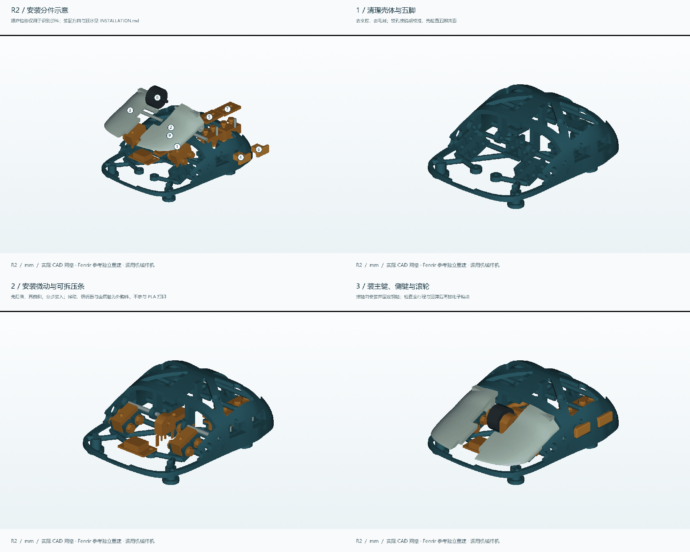

# Quietmirror · Fenrir / MiniSE R2 鼠标机械样机

**当前版本 R2：续接分享记录中的 Fenrir / MiniSE 重建方案，完成真实 CAD、9 个打印分件、机械接口、运动和装入检查、原生 FreeCAD、实际切片与有限元记录。**

主壳长 × 宽 × 高为 **88.236 × 66.096 × 30.564 mm**。这是 +8% 的布局试验；五个 Ø8 mm 脚、微动、编码器、螺钉和 USB-C 等功能尺寸单独保持。人体工学、打印公差、实际点击力度、寿命与无线电子功能仍需实物验证。

**[完整 R2 说明与检查结果](reports/rebuild_r2/README.md)** · [设计思路](reports/rebuild_r2/DESIGN.md) · [打印与装配](reports/rebuild_r2/INSTALLATION.md) · [当前全部文件 ZIP](https://github.com/Quietmirror/github/archive/refs/heads/main.zip)

## 下载

| 文件 | 内容 |
|---|---|
| [9 个打印分件 STL](releases/Fenrir-MiniSE-R2/R2_PRINT_STL.zip) | 主壳、左右主键、双侧键、两片可拆压条、滚轮与载架；附装配说明 |
| [打印 3MF](releases/Fenrir-MiniSE-R2/FENRIR_MINISE_R2_PLA_PRINT_PLATE.3mf) | 嵌入配置并已实际切片；换成自己的机器配置后重切 |
| [实体 STEP](releases/Fenrir-MiniSE-R2/R2_STEP.zip) | 分件、硬件参考、总装与接口量规；硬件参考不打印 |
| [原生 FreeCAD](releases/Fenrir-MiniSE-R2/FENRIR_MINISE_R2.FCStd) | 已保存并重开检查的命名 BRep 实体；参数化历史在 Python/JSON 中 |
| [CAD 源码与参数](cad/rebuild_r2/) | 可编辑、可重新生成；[复现环境和顺序](cad/rebuild_r2/ENVIRONMENT.md) |

实际 PLA 切片总耗材 **43.99 g**、约 **5 小时 33 分 1 秒**，包含支撑和裙边；不是装好后的鼠标重量。9 个塑料件 CAD 总体积约 **19.037 cm³**，按 1.24 g/cm³ 折算约 23.61 g，电子元件与硬件另计。

## 本轮设计

- 独立实心主键顺接母壳，外壳采用镜像的大尺度三角／梯形窗口；侧键及内部机械安装区按实际需求布置。
- Z=0–5 mm 只保留五脚材料，连续承力筋抬高；新增上横撑和脚柱到中央托架的斜撑。
- 五枚 D2F 微动、EC10E 编码器、转轴、侧键导向与止挡均有独立机械参考；侧微动改为固定下座与可拆上压条。
- 真实检查 1953 对静态实体、五键各 31 个运动位置、24 个滚轮转角以及 17 个分步安装阶段。有限采样不能替代连续接触求解或实物试装。
- 五脚底面共面、9 个 STL 均封闭且各自单连通，自相交检查通过。局部薄边和小接口另有[壁厚审计](reports/rebuild_r2/thickness_volume_audit.json)，没有宣称全局壁厚处处达标。
- [有限元报告](reports/rebuild_r2/FEM_REPORT.md)保留材料假设、支承、反力、逐档网格收敛与峰值应力结果；计算不等于打印成品强度认证。

[俯视](views/rebuild_r2/02_top.png) · [侧视](views/rebuild_r2/03_left_side.png) · [底视](views/rebuild_r2/04_bottom.png) · [五脚区域](views/rebuild_r2/05_five_feet_band.png) · [爆炸图](views/rebuild_r2/06_exploded.png) · [内部包络](views/rebuild_r2/10_internal_envelopes.png)

## 历史与后续

**V0.1–V0.9 原文件全部保留。** [V0.9 原首页](README_V0.9.md)与[原历史索引](HISTORY.md)继续可用；[R1 原始快照](releases/Fenrir-MiniSE-R2/R1_07fcd46_UNACCEPTED.zip)按上游提交保存并标明未验收。版本关系和保存方式见 [R2 历史说明](HISTORY_R2.md)。

R2 的电子适配排在机械试装之后。旧 V0.9 的 ATK A1 Plus 与 PAW3950 估计布局仍是历史示意，不能当作 R2 已匹配的真实主板。400–6400 DPI、2.4 GHz / 1 kHz、宏、LOD、五键、开关、充电、无可选 Sync 增强及 12 小时续航仍是后续目标。[待测尺寸与电子边界](reports/rebuild_r2/DESIGN.md)

本轮工程、工具与缓存保存于 `D:\Projects\Quietmirror`。本项目没有复制原厂 CAD 或受限商业扫描；实际读取文件与来源见 [PROVENANCE](reports/rebuild_r2/PROVENANCE.md)，许可为 [CERN-OHL-P-2.0](LICENSE)，沿革署名见 [原 NOTICE](NOTICE.md) 与 [R2 NOTICE](reports/rebuild_r2/NOTICE_R2.md)。
