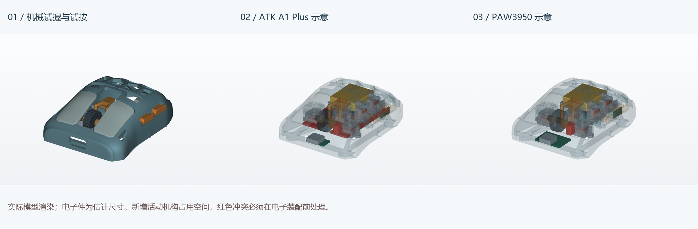
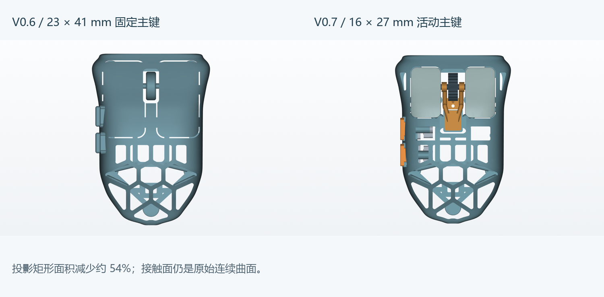

# Quietmirror · 右手指握鼠标

**当前 V0.7：缩小左右主键，增加前部镂空；按毒蝰 V3 Pro 的侧键外形方向重新设计细长双侧键。交付 20 件可打印机械试按套件、ATK A1 Plus 示意和 PAW3950 半组装板示意。V0.1–V0.6 全部保留。**

**[完整项目 ZIP，含所有历史版本](https://github.com/Quietmirror/github/archive/refs/heads/main.zip)** · [历史版本](HISTORY.md) · **[装配、辅料和打印说明](reports/v07/ASSEMBLY.md)** · [电子限制与功能目标](reports/v07/ELECTRONICS.md)

## 下载这次的三个版本

| 版本 | 文件 | 用途 |
|---|---|---|
| **机械试握/试按套件** | **[打印托盘 3MF](exports/v07/quietmirror_V0.7_PRINT_PLATE.3mf)** · **[20 个分件 STL/STEP](exports/v07/print/)** · [装配 STEP](exports/v07/quietmirror_V0.7_MECHANICAL_ASSEMBLY.step) · [观察 3MF](exports/v07/quietmirror_V0.7_MECHANICAL_VIEW_ONLY.3mf) | 装入五枚示例轻触开关后测试点击和回位；轮体可转动、滚轮架可下压。设计已做几何检查，尚未实物装配 |
| **ATK A1 Plus 主板示意** | [装配 STEP](exports/v07/quietmirror_V0.7_ATK_A1_PLUS_ESTIMATED.step) · [观察 3MF](exports/v07/quietmirror_V0.7_ATK_A1_PLUS_VIEW_ONLY.3mf) · [净空 STEP](exports/v07/quietmirror_V0.7_ATK_A1_PLUS_CLEARANCES.step) | 供体型号、实际板形/孔位/传感器仍未确认；估计整板与新增试按机构有冲突 |
| **PAW3950 半组装板示意** | [装配 STEP](exports/v07/quietmirror_V0.7_PAW3950_CUSTOM_ESTIMATED.step) · [观察 3MF](exports/v07/quietmirror_V0.7_PAW3950_CUSTOM_VIEW_ONLY.3mf) · [净空 STEP](exports/v07/quietmirror_V0.7_PAW3950_CUSTOM_CLEARANCES.step) | 主控、传感器和 RF 分板空间方案；编码器与打印试按机构的接口尚未解决 |

只有 **PRINT_PLATE.3mf / print/** 是打印文件。装配场景含重叠的估计电子包络或非打印开关，不应整场景合并打印。`placed/` 保留装配坐标。[先打印间隙校准件](exports/v07/calibration/)。

## 外形和操作机构

- 左右主键的名义触感区域由 **23 × 41 mm 缩为 16 × 27 mm**，矩形投影面积减少约 **54%**；曲面触感面保留，按键边口增加 0.4 mm 圆角，平面转角 R3 mm。尺寸仍是试握假设。
- 保留 12 个后壳孔的轮廓分区，并在主键释放区域增加 **4 个镜像减重孔轮廓**。中央增加 **14.2 × 34 mm** 滚轮架装配开口，与主键/滚轮的安装开口连通；不将这些连通开口重复计数为独立孔。接触面不开孔，支撑和安装区保留必要实体。
- 双侧键改为约 **12 × 4.45 mm** 的细长轮廓，名义中心距前端 **39.5 / 53.5 mm**、高度 **15.5 / 16.0 mm**，端部收窄、外缘倒圆。本轮按 Viper V3 Pro 理解“v3p”，没有复制商业 CAD 或按照片臆测实测尺寸。[实际查看资料](references/V0.7_REFERENCE_NOTES.md)
- 五个输入位置各有独立柱塞、导向、可拆挡片及开关托架。打印轮体、3 mm 轴、轴端垫片和滚轮支架可以分开装配；可选 0.8 mm 弹片用于机械段落感。
- **点击和回位需要另装五枚 6 × 6 × 5 mm 轻触开关。** 仅打印件不能评价真实鼠标微动手感；示例开关是机械测试辅料，未指定最终主板开关。滚轮的转动与段落试验不产生电脑滚动信号。
- CAD 最大空行程 **0.4 mm**，示例轻触开关标称行程 **0.25 mm**。装配时必须调校开关高度和限位；不可直接把 0.4 mm 当作开关许可行程。

## 验证与用料

| 检查 | 实际结果 |
|---|---|
| 20 个塑料件 | 全部有效单实体；STL 单连通、封闭、法线一致；自相交面数 0 |
| 五键运动 | 每键 9 个位置，共 45 个位置检查；0–0.4 mm 内未发现刚性体积干涉 |
| 装入路径 | 四键和滚轮架各 31 个位置；移除挡片、托架和其他活动件后，从规定方向装入，采样检查通过 |
| 滚轮转动 | 使用 Ø15 / 内孔 Ø3.5 × 宽 5.2 mm 的连续圆环外包络检查，与壳体、轴和支架无刚性干涉 |
| 可选弹片 | 有意与齿峰接触，属于弹性段落结构；已记录接触体积，没有做弹性仿真或寿命试验 |
| 底部 | 与 V0.6 在 **Z≤5.4 mm** 的布尔对称差体积 **0.000000 mm³**；五脚 45 点仍共面 Z=0 |
| 普通壳面壁厚 | 445 个法向样本，最小 **1.731 mm**；不等于全局最薄壁证明 |
| 对称 | 侧键及其安装区域以外，BODY 镜像网格偏差最大 **0.017 mm**；左右主键最大 **0.017 mm** |
| 实际壳体尺寸 | 长 × 宽 × 高 **90.312 × 61.970 × 28.002 mm**；毫米单位、100% 导入 |
| 20 个塑料件 CAD 总体积 | **21.693 cm³**；不包含另购开关、螺钉、主板、电池和脚贴 |

实际使用 PrusaSlicer 2.9.6 对最终 3MF 切片：0.4 mm 喷嘴、0.2 mm 层高、4 壁、20% gyroid、PLA 1.24 g/cm³。模型 **27.14 g**，支撑 **17.46 g**，裙边 **0.87 g**，总耗材 **45.47 g**，约 **5h 53m 28s**。3MF 不加载外部 INI 重切片，8 项关键配置从 G-code 回读一致。它是通用估计配置，需换成实际打印机配置后打印。

没有实物打印、称重、摩擦/手感、强度或电子功能实测。机械试按增加了托架、挡片等零件，本轮没有把整套重量当作最终轻量化鼠标重量。[完整几何报告](reports/v07/validation.json) · [壁厚/对称](reports/v07/geometry_checks.json) · [切片数据](reports/v07/slice_summary.json)

## 外部建模软件建议

**推荐下一阶段用 FreeCAD 的装配工作台继续。** 现在需要围绕真实开关、编码器、PCB 和电池建立固定、滑动、转动约束，并检查预压、回位及装配空间；这些适合参数化 CAD 装配。当前源文件本身使用 CadQuery/OpenCascade 进行实际实体建模，不是从渲染图转成的 STL。

已附 [FreeCAD 导入宏](cad/open_v07_in_FreeCAD.FCMacro)，可在 FreeCAD 中把分件 STEP 导入为命名零件并保存本地 FCStd。**宏未在本机 FreeCAD 中执行验证；STEP 导入不会还原 CadQuery 的参数历史树，宏也不会自动建立已求解关节。** 主要可编辑参数仍在 [parameters_v07.json](cad/parameters_v07.json) 与 [mechanisms_v07.py](cad/mechanisms_v07.py)。

[FreeCAD 官方装配工作台文档](https://github.com/FreeCAD/FreeCAD-documentation/blob/main/wiki/Assembly_Workbench.md)列有固定、滑动和转动关节。后续先完成试按和实测元件，再做正式装配；不建议在没有真实 PCB 尺寸时反复修改估计孔位。

## 源码、复现与历史

[模型生成器](cad/build_v07.py) · [机构源码](cad/mechanisms_v07.py) · [参数](cad/parameters_v07.json) · [电子源码](cad/electronics_v07.py) · [电子参数](cad/electronics_v07.json) · [复现步骤](cad/PARAMETERS_V0.7.md)

V0.1–V0.6 的模型、源码、参数、图、报告保持原文件。V0.6 当时的首页保存为 [README_V0.6.md](README_V0.6.md)。[历史保留核对](reports/v07/history_preservation.json) · [许可证](LICENSE) · [既有署名](NOTICE.md)。
