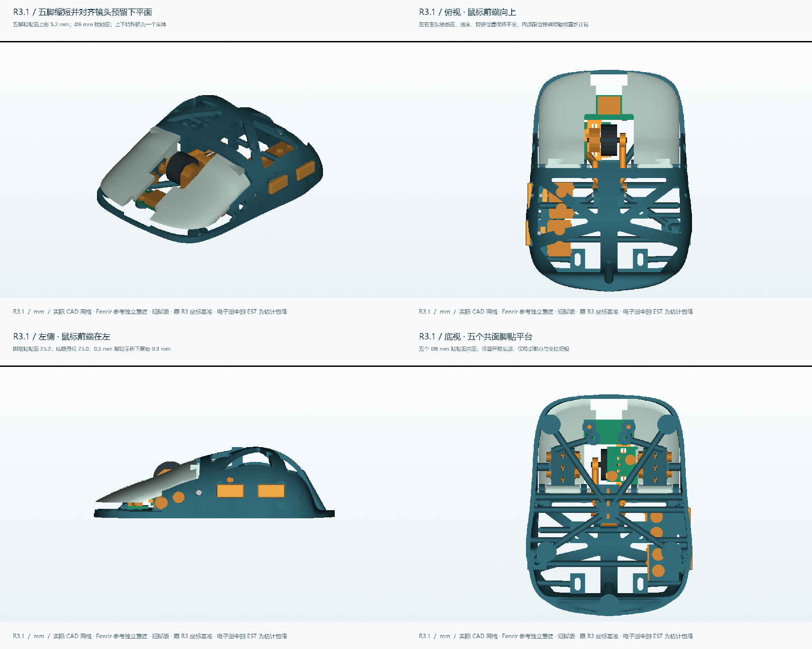

# Quietmirror · Fenrir / MiniSE R3.1

**五个脚贴点已缩短 5.2 mm，粘贴面与镜头预留空间的下平面 Z5.2 对齐。** Ø8 mm 粘贴区域和五脚共面保留；只需重打 BODY，其余 8 个打印件可沿用 R3。

[详细改动与验证](reports/rebuild_r3_1/README.md) · [单独下载 BODY](exports/rebuild_r3_1/print/BODY.stl) · [全部 STL](releases/Fenrir-MiniSE-R3.1/R3_1_PRINT_STL.zip) · [STEP 三场景](releases/Fenrir-MiniSE-R3.1/R3_1_STEP.zip) · [FreeCAD](releases/Fenrir-MiniSE-R3.1/FENRIR_MINISE_R3_1.FCStd) · [3MF](releases/Fenrir-MiniSE-R3.1/FENRIR_MINISE_R3_1_PLA_PRINT_PLATE.3mf) · [可编辑源码](cad/rebuild_r3_1/)

**脚贴厚度需计入尺寸链：** 按实测 0.5 mm 脚贴的示例，底框最小离地间隙约 0.30 mm。未贴脚贴时，底框局部会比粘贴面低约 0.20 mm。当前镜头是估计包络，真实光学工作高度尚未验证。

98 个实体／包络、4753 对静态检查通过；五键各 41 个位置、滚轮 72 组合、18 个机械装入阶段通过。9 个打印网格封闭、各自连通，无检出的自相交。实际打印、公差、强度和电子功能未实测。

实际切片估计：**PLA 37.75 g，4h 56m 29s**，包含支撑和裙边。打印机与耗材不同需重切。[完整检查与安装注意事项](reports/rebuild_r3_1/README.md)

历史保留：[R3 原首页](README_R3.md) · [R3 报告](reports/rebuild_r3/README.md) · [R2 原首页](README_R2.md) · [更早历史](HISTORY.md)。两种主板仍按[R3 兼容性边界](reports/rebuild_r3/COMPATIBILITY.md)理解，不将估计包络当成实测适配。

许可 [CERN-OHL-P-2.0](LICENSE)；保留[原署名](NOTICE.md)与[R3.1 署名](reports/rebuild_r3_1/NOTICE_R3_1.md)。
