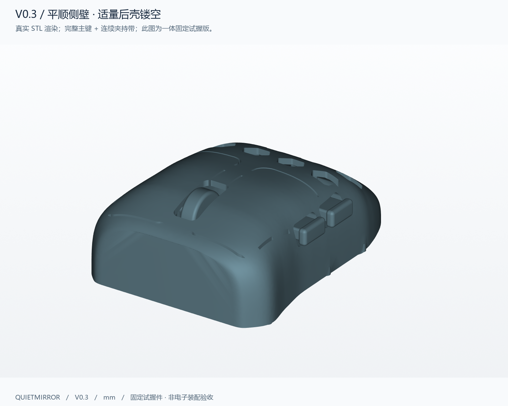
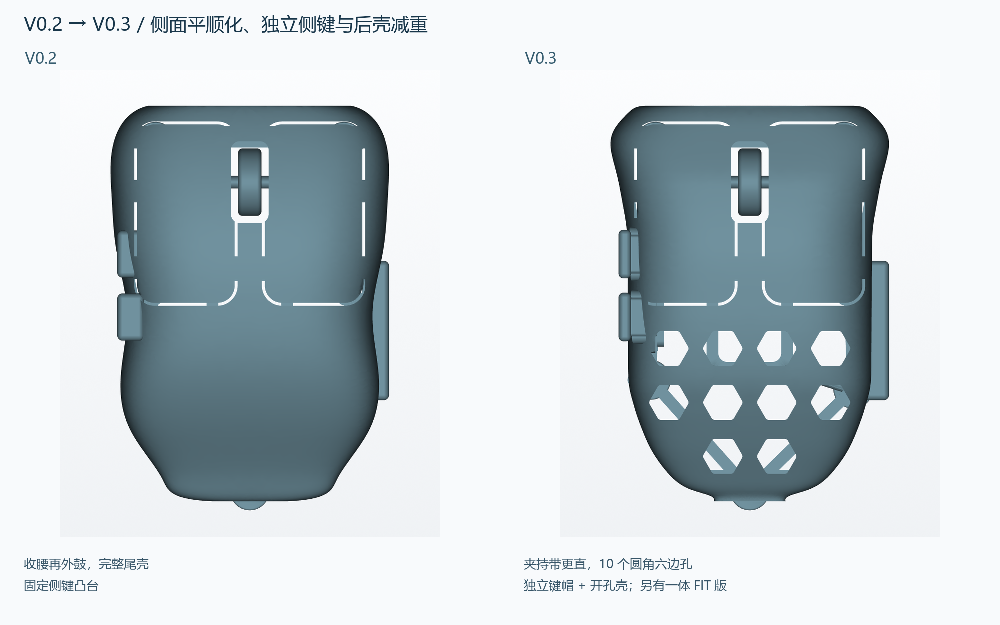
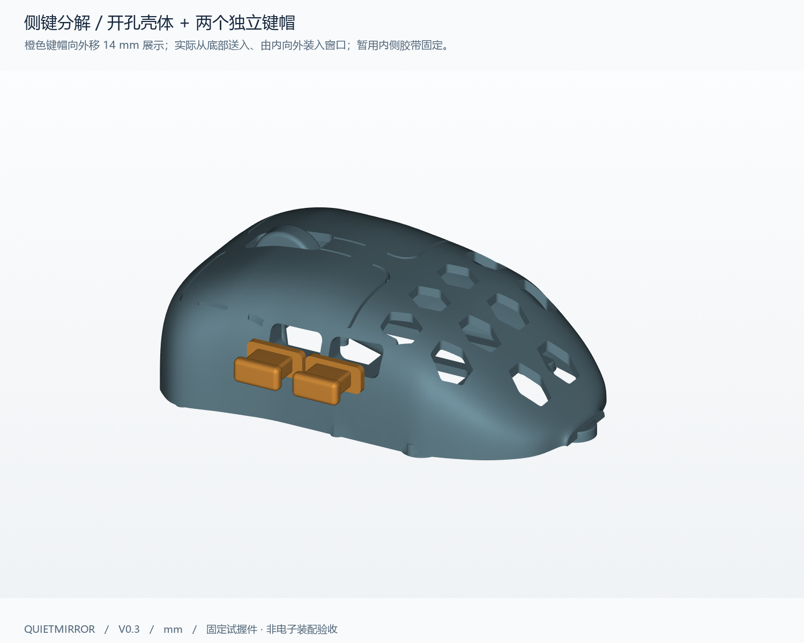

# Quietmirror · 右手指握鼠标

**当前版本 V0.3：更平顺的侧面、两个独立侧键部件、适量后壳镂空。**

这是可编辑、可3D打印的右手 fingertip / fingergrip 鼠标试握项目。延续游狼 HSK / HTR 的短机身方向，本轮参考 Finalmouse ULX 和 Razer Viper Mini Signature Edition 的分区：**主键和侧面夹持区保留完整触面，后壳布置10个圆角六边孔。** 所有图均来自实际生成的模型，不是概念效果图。



长90 ×最大外宽约62 ×高31 mm；中段夹持截面约53.61 mm。尺寸是试握假设，尚未实物打印和握持验证。左右主键和滚轮仍固定；侧键提供一体固定版和可分开打印的接口原型。

## 下载：按用途选择

| 文件 | 用途 |
|---|---|
| **[V0.3 一体试握 STL](exports/v03/quietmirror_fingertip_V0.3_FIT.stl)** | 优先打印；两个侧键也固定，整件一个连通实体 |
| **[一体版 3MF](exports/v03/quietmirror_fingertip_V0.3_PRINT.3mf)** | 内含通用PLA估算配置，脚面朝下、已居中；打开后选择自己的打印机 |
| [一体版 STEP](exports/v03/quietmirror_fingertip_V0.3_FIT.step) | 有效B-rep实体 |
| **[预留侧键窗口的壳体 STL](exports/v03/quietmirror_fingertip_V0.3_SHELL.stl)** · [STEP](exports/v03/quietmirror_fingertip_V0.3_SHELL.step) | 带导向加强台，配下方两个键帽；主键和滚轮仍固定 |
| **[前侧键 STL](exports/v03/side_button_1_V0.3_PRINT.stl)** · [STEP](exports/v03/side_button_1_V0.3_PRINT.step) | 已按内侧限位边朝下摆好打印方向 |
| **[后侧键 STL](exports/v03/side_button_2_V0.3_PRINT.stl)** · [STEP](exports/v03/side_button_2_V0.3_PRINT.step) | 当前与前键同形，保留独立文件供后续改形 |
| **[壳体 + 两键帽装配坐标 STEP](exports/v03/side_button_assembly_V0.3.step)** | 查看真实相对位置；不是整体打印文件 |
| [可编辑CadQuery源码](cad/build_v03.py) + [参数JSON](cad/parameters_v03.json) | [参数和接口说明](cad/PARAMETERS_V0.3.md)；STEP没有原生Fusion/SolidWorks历史树 |
| [电子参考包络 STEP](exports/v03/electronic_envelopes_V0.3_ESTIMATES.step) | 16个独立估计包络，不参与打印，也不是装配验收 |

GitHub文件页可用 **Download raw file** 下载。STL按毫米、100%比例导入。不要把FIT文件和SHELL文件叠在同一位置打印；它们是两种用途的选项。

## 本轮改了什么



| 项目 | V0.2 | V0.3 |
|---|---|---|
| 中段侧面 | 收腰后再外鼓 | 减少内收和外鼓，夹持带接近直线 |
| 中段宽度起伏，Z13 /距前端32–60 | 4.879 mm | **0.963 mm** |
| 中心截面握宽，距前端46 /Z13 | 54.043 mm | **53.606 mm** |
| 后壳 | 完整连续壳 | **10个圆角六边孔，最小平面筋距3 mm** |
| 主键、侧握区 | 完整触面 | 继续保留，不把孔阵铺进主要指肚区域 |
| 侧键 | 两个固定凸台 | 两个窗口、导向台、独立键帽与内侧限位边；另有一体FIT版 |
| PLA本体切片估重 | 25.851 g | **25.586 g** |
| 含支撑与裙边 | 44.41 g | **41.87 g** |

孔阵相对本轮不开孔的同形壳移除约 **1.183 cm³** 材料，按1.24 g/cm³ PLA折算约 **1.47 g**。侧键接口、限位边和尾根补强也增加材料，因此最终本体相对V0.2仅轻约 **0.26 g**。孔阵不是整件大幅减重的保证；这一版优先验证侧面和侧键方向。

## 图纸、设计思路与验证

**[完整设计与验证报告](reports/v03/DESIGN.md)** · [打印说明](slicing/V0.3_PRINTING.md) · [电子空间和待测清单](reports/v03/ELECTRONICS.md) · [试握反馈表](reports/v03/FIT_FEEDBACK.md)

[俯视](views/v03/02_top.png) · [左侧](views/v03/03_left_side.png) · [底视](views/v03/04_bottom.png) · [右侧](views/v03/05_right_side.png) · [内部包络](views/v03/06_envelopes.png) · [尺寸图](views/v03/07_dimensions.png) · [包络尺寸表](views/v03/08_envelope_layout.png) · [实际切片截面](views/v03/09_slice_layers.png)



两个键帽从底部中前开口送入内腔，先避开底筋和侧壁导向台，在内侧抬到窗口高度，再向外推入。内侧限位边防止向外掉出，试握时可用内侧可移除胶带暂时防止向内脱落。两个侧键窗口是12.0 ×6.6 mm，键面10.8 ×5.4 mm，名义单边间隙0.6 mm；默认装配最近间隙分别0.30 /0.20 mm。[半透明装配图](views/v03/12_side_buttons_fitted.png)

**独立键帽是接口原型，还没有真实点击机构。** 没有弹簧、活铰链、微动支座或已验证的开关行程。FIT版中的小连接只用于固定触感位置，不能用它评估按键力和回弹。

## 已做的实际检查

- FIT、SHELL、前后键帽四个单件均为有效STEP单实体；对应STL封闭、法线一致、单一连通，自相交0。
- FIT有109,408个三角面；非流形边/点0，边界边0，没有用补洞或丢弃碎片掩盖几何错误。
- 五个Ø8.8 mm脚贴平台各检查中心及周边8点，共45点，全部Z=0。适配约Ø7–7.5 mm同厚圆点脚贴。
- 620个常规曲面法向壁厚样本，最小约1.657 mm、中位约1.879 mm；内限位边名义厚1.6 mm，FIT临时侧键连接最小设计截面方向1.2 mm。采样不等于全表面最薄壁连续证明。
- 独立键帽与壳体、两个键帽之间均无静态体积相交；两条建议装入路径共105个位置样本未检出相交。离散路径检查不等于连续扫掠或实物装配验收。
- PrusaSlicer实际读入 **61.987 ×90.000 ×31.000 mm**，模型1个连通部分。CAD高精度积分体积 **20.422 cm³**；STL体积 **20.409 cm³**，差约0.063%。

原始数据：[几何/网格/壁厚/五脚](reports/v03/validation.json) · [CAD及接口](reports/v03/cad_metrics.json) · [装入路径采样](reports/v03/side_button_insertion.json) · [切片器尺寸](reports/v03/slicer_model_info.txt)

## 打印估算

首轮配置：0.4 mm喷嘴、0.2 mm层高、4周壁、20% gyroid、5层顶底、PLA密度1.24 g/cm³。一体件五脚面朝下；有机支撑仅从热床生成，支撑内顶壳、轮轴/轮架、侧键和低托边；4 mm裙边。从开放底部拆支撑，不要剪断模型自身的底筋。端缘、孔口和主键窄缝需轻修毛刺。

| 打印选项 | 本体 | 含支撑/裙边耗材 | 通用配置时间 |
|---|---:|---:|---:|
| 一体 FIT | 25.586 g | 41.87 g | 5小时13分20秒 |
| 开孔 SHELL | 24.415 g | 40.65 g | 5小时03分45秒 |
| 每个独立键帽 | 0.579 g | 0.91 g | 10分38秒 |

最终3MF不额外加载INI重切片得到41.83 g /5小时13分07秒，16项关键设置一致；两次切片差0.04 g、13秒，记录原始差异。以上均是实际切片的估算，没有实物打印、去支撑、称重或强度试验。[切片结果](reports/v03/slice_summary.json) · [分件估算](reports/v03/separate_parts_slice.json) · [3MF重切核对](reports/v03/3mf_roundtrip.json)

## 人体数据与电子装配边界

手长约230 mm、拇指尖到小指尖张开跨度约190 mm，来自近似AR测量。**190 mm不是掌宽或握宽**；掌宽、指节和真实握姿未知。本项目没有按手长整体缩放，也没有填入伪造人体数据。

未来目标仍为PAW3950、2.4 GHz无线1000 Hz、左右主键、中键/滚轮、两个拇指侧键。供体只按用户称呼记录为 **“ATK 蜻蜓 A1 Plus”**，准确型号、传感器版本、PCB外形及孔位均待确认。PAW3950不规定统一板型；无线1K由主板、固件和匹配接收器共同实现。

本轮电子框是估计包络。当前侧键板框与新导向台/限位边相交，电池仍穿入下降的尾壳，主板和编码器布局也需调整。没有制造估计安装孔；当前STL不能直接当成供体替换壳。传感器轴线沿Z，镜头至鼠标垫的高度必须按实际PCB、镜头、底面和脚贴厚度组成尺寸链确认。[详细冲突与待测尺寸](reports/v03/ELECTRONICS.md)

## 编辑、复现和历史版本

Python3.12，依赖见[requirements.txt](requirements.txt)，CadQuery2.8.0 / OpenCascade7.9.3。项目根目录执行：

```powershell
py -3.12 -m venv .venv
.\.venv\Scripts\python.exe -m pip install -r requirements.txt
.\.venv\Scripts\python.exe cad\build_v03.py
.\.venv\Scripts\python.exe cad\validate_v03.py
.\.venv\Scripts\python.exe cad\check_side_button_path_v03.py
.\.venv\Scripts\python.exe cad\render_v03.py
.\.venv\Scripts\python.exe cad\make_diagrams.py --version 0.3
.\.venv\Scripts\python.exe cad\write_electronics_v03.py
```

源码共用[build_mouse.py](cad/build_mouse.py)的几何辅助函数及包络定义。参数、视图和切片脚本完整保留；渲染字体为Windows微软雅黑，其他平台需调整字体路径。改参数后重新检查间隙、连通、壁厚和切片。[V0.2存档](README_V0.2.md) · [V0.1存档](README_V0.1.md)

## 参考、署名与许可

实际审阅了[olliebella](https://github.com/badjeff/olliebella)的STL、[Kotinos](https://github.com/pseudoku/Kotinos)的STL/SCAD、[paw3395-pcb](https://github.com/badjeff/paw3395-pcb)的KiCad板框。采用紧凑结构、五圆点脚贴、独立触达参数和电子包络分开的思路，没有套用Kotinos的HSK Pro主板孔位。[详细开源源文件记录](references/REFERENCE_REVIEW.md)

V0.2的[游狼外观参考](references/GWOLVES_REFERENCE.md)保留；V0.3新增[Finalmouse / Mini SE审阅记录](references/FINALMOUSE_MINISE_REFERENCE.md)，含实际查看的官方照片及ULX Cheetah形状STL。商业照片、STL不作为本项目开源资产分发，没有复制商业几何或品牌装饰。

Quietmirror源代码、原创建模与文档采用 **CERN-OHL-P-2.0**，见[LICENSE](LICENSE)、[NOTICE](NOTICE.md)。上游参考渲染及许可保留原作者署名。
