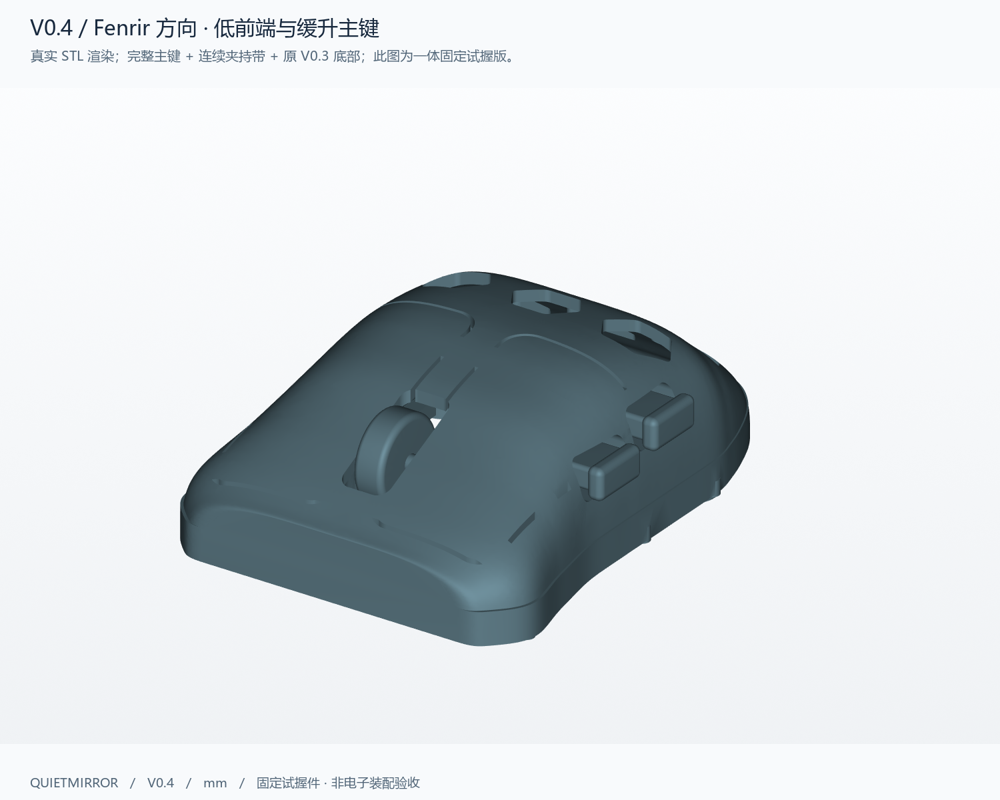
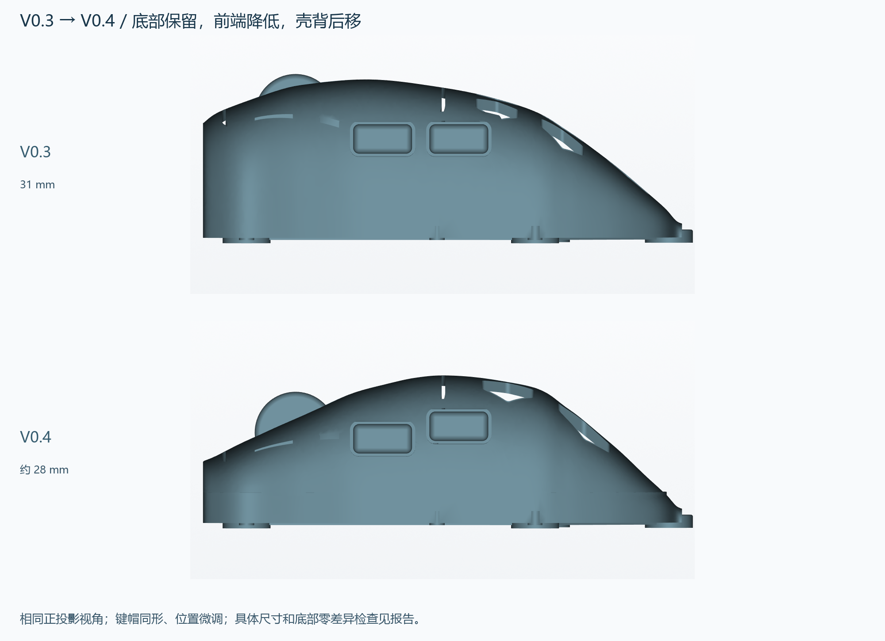
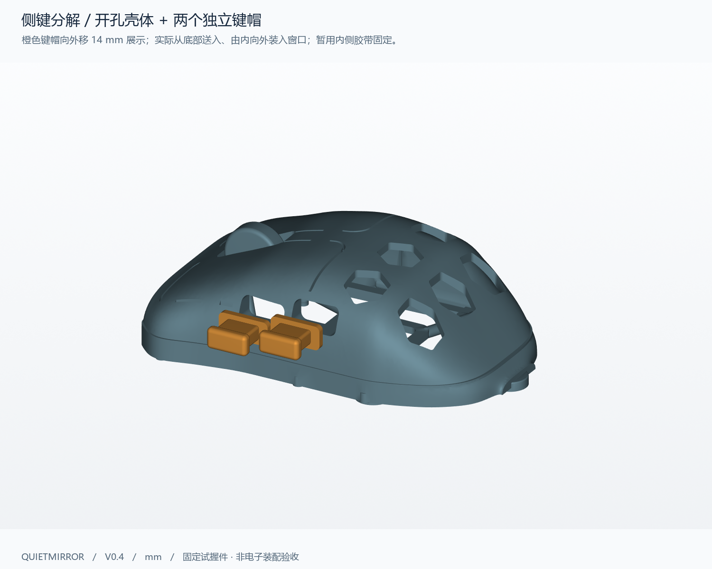

# Quietmirror · 右手指握鼠标

**当前版本 V0.4：参考游狼 Fenrir 的低前端与缓升主键，V0.3 底部不变。V0.1–V0.4 全部保留。**

这是可编辑、可3D打印的右手 fingertip / fingergrip 试握项目。V0.4实际查看了 [Fenrir Pro / Asym 官方图片](references/FENRIR_REFERENCE.md)，重新设计上部轮廓；主键和夹持面保持完整，后壳改为6个较大的圆角六边窗口。图中是实际STL渲染。

**[全部历史版本与下载表](HISTORY.md)** · **[一次下载整个项目 ZIP，含所有版本](https://github.com/Quietmirror/github/archive/refs/heads/main.zip)**

## 当前版本下载

| 文件 | 用途 |
|---|---|
| **[一体试握 FIT STL](exports/v04/quietmirror_fingertip_V0.4_FIT.stl)** · [STEP](exports/v04/quietmirror_fingertip_V0.4_FIT.step) | 优先试握：主键、滚轮、两侧键固定，一个连通实体 |
| **[带估算配置的 3MF](exports/v04/quietmirror_fingertip_V0.4_PRINT.3mf)** | 脚面朝下、毫米、100%比例、已居中；打开后选择实际打印机 |
| **[开侧键窗口的 SHELL STL](exports/v04/quietmirror_fingertip_V0.4_SHELL.stl)** · [STEP](exports/v04/quietmirror_fingertip_V0.4_SHELL.step) | 配下方两个独立键帽；主键和滚轮仍固定 |
| [前侧键 STL](exports/v04/side_button_1_V0.4_PRINT.stl) · [STEP](exports/v04/side_button_1_V0.4_PRINT.step) | 已按内侧限位边朝下摆好 |
| [后侧键 STL](exports/v04/side_button_2_V0.4_PRINT.stl) · [STEP](exports/v04/side_button_2_V0.4_PRINT.step) | 同形独立部件，安装高度与前键不同 |
| [壳体 + 两键帽装配位置 STEP](exports/v04/side_button_assembly_V0.4.step) | 三个实体的相对位置；不是叠在一起打印的文件 |
| [可编辑 CadQuery 源码](cad/build_v04.py) · [参数 JSON](cad/parameters_v04.json) | [参数、坐标和复现说明](cad/PARAMETERS_V0.4.md)；依赖源码随项目提供 |
| [16个电子估计包络 STEP](exports/v04/electronic_envelopes_V0.4_ESTIMATES.step) | 不参与打印，不代表真实供体尺寸或可装配 |

GitHub文件页可用 **Download raw file** 下载；STL按毫米导入。FIT与SHELL是两种用途选项，不要叠在同一位置打印。

## 这次改了什么

| 项目 | V0.3 | V0.4 |
|---|---|---|
| 整体尺寸，长×宽×高 | 约90×62×31 mm | **90.002×61.987×28.002 mm** |
| 鼻部壳顶参考高度 | 22 mm | **12 mm**，主键面向后缓升 |
| 壳背峰值位置 | 距前约30 mm | 距前约44 mm；末端继续短低 |
| 固定滚轮顶部 | 31 mm | **25 mm**，上部支撑收进壳内 |
| 后壳窗口 | 10个9×9六边孔 | **6个12×11外接框圆角六边窗口**，名义最小平面筋距3 mm |
| 侧键 | 前后中心Z19.2 | **前Z16.5 /后Z18.8**，纵向仍为距前33/47；键帽同形 |
| 中心夹持截面，距前46 /Z13 | 53.606 mm | **53.062 mm**；仍是试握假设 |
| 五脚、底筋、传感器框、右托边 | V0.3结构 | **整个Z≤6 mm区域原样保留** |
| PLA本体切片估重 | 25.586 g | **23.345 g** |

底部由已交付V0.3 STEP直接提取；上方增加0.6 mm高过渡边，再连接新壳。保存后的FIT和SHELL都做了冻结区域双向布尔差检查：**FIT：旧减新 0.000000 / 新减旧 0.000000 mm³；SHELL：旧减新 0.000000 / 新减旧 0.000000 mm³**。不是只比较五个脚的位置。[底部检查原始数据](reports/v04/bottom_preservation.json)

## 验证与打印估算

- 四个单件（FIT、SHELL、前键、后键）均为有效STEP单实体；STL单连通、封闭、法线一致、自相交0。
- FIT共112,162个三角面，五脚各测9点，45点均位于Z=0。脚贴平台Ø8.8，适配约Ø7–7.5的同厚圆点脚贴。
- 常规壳面法向采样523点：最小1.717 mm，中位1.881 mm；不是全表面的连续最薄壁证明。侧键内限位边1.6 mm；FIT固定小桥局部为1.2 mm。
- CAD积分体积约18.654 cm³；打印STL体积18.577 cm³，差0.410%。切片重量来自实际刀路，而非把CAD实体体积直接当耗材量。
- 独立键帽与壳体无静态体积相交，最近间隙约0.300/0.217 mm；装入路径离散核对记录见报告，仍需实物配合验证。

0.4 mm喷嘴、0.2 mm层高、4周壁、20% gyroid、5层顶底、PLA密度1.24。五脚面朝下，有机支撑仅从热床生成，4 mm裙边。**FIT本体 23.345 g，支撑 14.934 g，含支撑/裙边总计 38.45 g，估时 4h 50m 41s。** 最终3MF另行重切片得到38.43 g；16项关键设置一致。没有实物打印、去支撑、称重或强度试验。

**[详细设计思路与验证](reports/v04/DESIGN.md)** · **[打印说明及分件估算](slicing/V0.4_PRINTING.md)** · [全部几何数据](reports/v04/validation.json) · [试握反馈表](reports/v04/FIT_FEEDBACK.md)

## 视图与侧键

[俯视](views/v04/02_top.png) · [左侧](views/v04/03_left_side.png) · [底视](views/v04/04_bottom.png) · [右侧](views/v04/05_right_side.png) · [尺寸图](views/v04/07_dimensions.png) · [冻结底部单独显示](views/v04/13_frozen_bottom.png)

独立侧键从底部送入内腔，再由内向外放入窗口；内侧限位边防止向外脱落，临时试握可用可移除胶带从内侧防止向内掉落。当前没有弹簧、开关支座或已验证行程，不能评价真实点击力度与回弹。[半透明装配图](views/v04/12_side_buttons_fitted.png)

## 手部与电子装配边界

手长约230 mm、张开跨度约190 mm来自照片的近似AR测量。**190 mm不是掌宽或鼠标握宽**；没有按手长整体缩放，掌宽、指节和实际握姿仍未知。原90×62×31 /约54 mm握宽是试握起点；V0.4把上部降低到约28 mm，必须靠试握反馈判断是否合适。

电子目标仍为PAW3950、2.4 GHz无线1000 Hz、左右主键、中键/滚轮和两侧键。供体仅记为用户所称 **“ATK 蜻蜓 A1 Plus”**，准确型号、传感器版本、PCB和孔位待确认。PAW3950不规定统一板型；无线1K依赖主板、固件和匹配接收器。

本版低前端会影响主键开关和编码器高度；电池、侧键板、USB-C及天线布局也未解决。16个参考框全部按估计标注，没有设置假装配孔。光轴沿Z，真实镜头高度须按PCB、镜头、底面、脚贴的尺寸链确定。**当前文件用于外形和触达试握，尚不能作为可装电子元件的替换壳。**

[电子包络与待测尺寸](reports/v04/ELECTRONICS.md) · [内部包络图](views/v04/06_envelopes.png) · [包络尺寸表](views/v04/08_envelope_layout.png)

## 源码、历史和署名

[复现步骤](cad/PARAMETERS_V0.4.md) · [Python依赖](requirements.txt) · [全部历史版本](HISTORY.md)。V0.4依赖的V0.3底部STEP也已包含在仓库，下载整个项目可直接取得。

原创模型与源码采用 [CERN-OHL-P-2.0](LICENSE)。已查看的olliebella、Kotinos和paw3395-pcb源文件及上游许可证见 [开源参考审阅](references/REFERENCE_REVIEW.md)；没有沿用HSK Pro孔位。Fenrir为商业外形参考，本轮未取得它的CAD/STL，也未复制网格。官网图保留外链和署名；本项目许可证不覆盖它们。[完整NOTICE](NOTICE.md)
