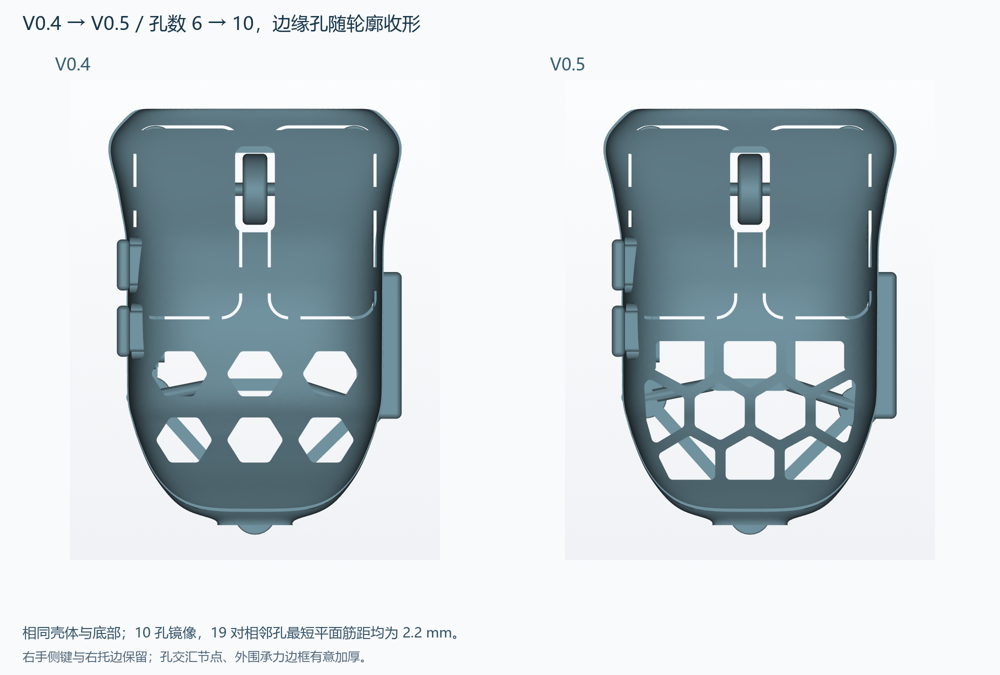
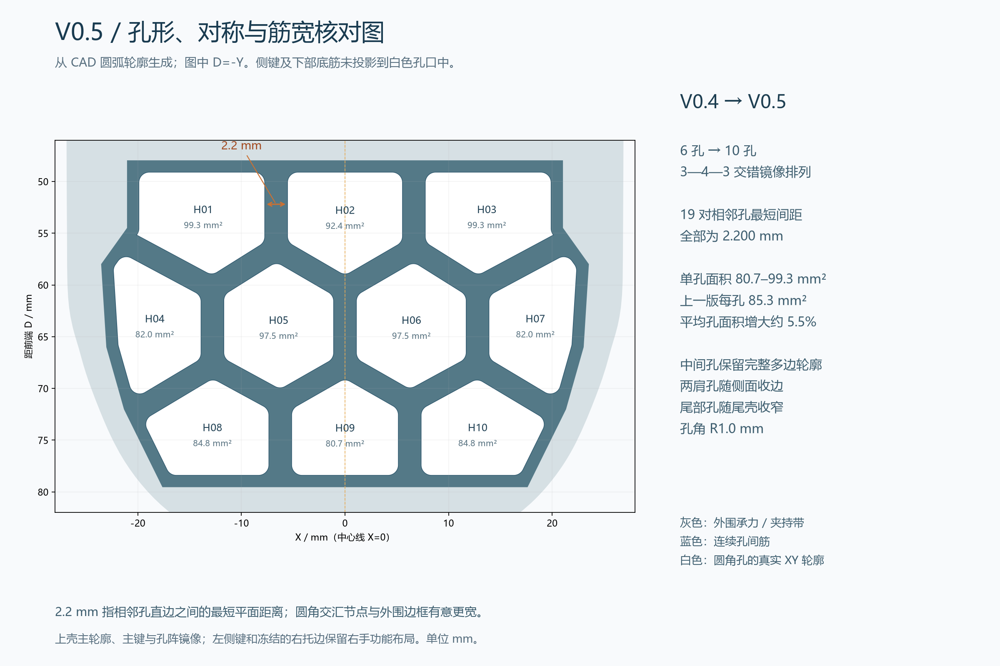

# Quietmirror · 右手指握鼠标

**当前 V0.5：后壳从 6 孔增加到 10 孔，孔间筋收窄为 2.2 mm，孔形随轮廓调整、左右镜像排列。V0.1–V0.5 全部保留。**

沿用 V0.4 的 Fenrir 方向外形：低前端、向后缓升主键和短低尾部。本轮只改后壳孔阵，单孔大小维持原来尺度，边缘孔分别收形，孔间筋更均匀。图为实际交付 STL 的渲染。

**[全部历史版本](HISTORY.md)** · **[一次下载整个项目 ZIP](https://github.com/Quietmirror/github/archive/refs/heads/main.zip)**

## 当前模型下载

| 文件 | 用途 |
|---|---|
| **[一体试握 STL](exports/v05/quietmirror_fingertip_V0.5_FIT.stl)** · [STEP](exports/v05/quietmirror_fingertip_V0.5_FIT.step) | 一个连通实体；主键、侧键与滚轮触感件固定 |
| **[带切片配置的 3MF](exports/v05/quietmirror_fingertip_V0.5_PRINT.3mf)** | 毫米、100%比例、五脚朝下；使用前选择实际打印机 |
| [开侧键窗口 SHELL STL](exports/v05/quietmirror_fingertip_V0.5_SHELL.stl) · [STEP](exports/v05/quietmirror_fingertip_V0.5_SHELL.step) | 配合下列独立键帽；主键和滚轮仍固定 |
| [前侧键 STL](exports/v05/side_button_1_V0.5_PRINT.stl) · [STEP](exports/v05/side_button_1_V0.5_PRINT.step) | 内侧限位边朝下的打印部件 |
| [后侧键 STL](exports/v05/side_button_2_V0.5_PRINT.stl) · [STEP](exports/v05/side_button_2_V0.5_PRINT.step) | 同形部件，安装高度不同 |
| [壳体与两键帽装配 STEP](exports/v05/side_button_assembly_V0.5.step) | 三实体的装配位置，不用于叠印 |
| [主生成器](cad/build_v05.py) · [孔形生成器](cad/vent_layout_v05.py) · [参数 JSON](cad/parameters_v05.json) | 可编辑 CadQuery 源码；[参数与复现](cad/PARAMETERS_V0.5.md) |
| [16 个电子估计包络 STEP](exports/v05/electronic_envelopes_V0.5_ESTIMATES.step) | 估计尺寸和摆位，不参与打印，不代表装配已验证 |

GitHub 文件页使用 **Download raw file** 下载。FIT 和 SHELL 是两种选择，不要叠在同一位置打印。整个项目下载包含生成器依赖的历史底部 STEP。

## 孔形和细筋具体变化

| 项目 | V0.4 | V0.5 |
|---|---|---|
| 孔数与排列 | 6，3—3 | **10，3—4—3 交错镜像排列** |
| 单孔面积，XY 投影 | 每孔 85.34 mm² | **80.68–99.28 mm²**；平均 90.03 |
| 孔间筋 | 旧报告尖角基形最小 3.0 mm；实际圆角孔最小 3.4 mm | **19 对相邻孔最短平面间距均为 2.200 mm** |
| 孔形 | 等形圆角六边孔 | 中央较完整，肩部、侧缘和尾部孔单独裁形；孔角 R1.0 |
| 本体 PLA 切片估重，使用同一配置 | 23.345 g | **22.190 g**，减少 1.155 g /4.95% |
| 尺寸，长×宽×高 | 约 90×62×28 mm | **90.002×61.987×28.003 mm** |
| 底部与五脚 | V0.3 冻结底部 | **整个 Z≤6 mm 区域不变** |

孔阵来自共享边界的分区，再对每个分区内缩 1.1 mm、做 R1.0 圆角；不是把所有孔缩小，也不是等距复制同一六边形。相邻直边因此保留一致筋距。多孔交汇节点、外围承力边框仍更宽，不能把 2.2 mm 理解为全表面任意方向都等厚。

**对称范围**：主壳轮廓、左右主键、滚轮中心和后壳孔阵以 X=0 镜像。沿用先前右手设计，左侧两个拇指键及冻结的右侧托边仍单侧保留，**完整 FIT 实体并非全特征镜像对称**。孔阵左右镜像差面积小于 1e-8 mm²；保存后的上壳曲面另做 5,000 点镜像距离采样，最大约 0.020 mm，属于 STL 曲面离散误差范围。

## 已完成的核对

- FIT、SHELL、两个独立键帽：每件 STEP 有效且为一个实体；STL 封闭、单连通、法线一致，自相交面数 0。
- FIT 111,548 个三角面；五脚各测 9 点，共 45 点均在 Z=0。脚贴平台 Ø8.8 mm，参考约 Ø7–7.5 mm 同厚圆点脚贴。
- 常规壳面 869 个法向样本，最小 1.695 mm；另在细筋上检查 57 点，最小 **1.734 mm**，没有低于 1.6 mm 的样本。有限采样不是连续全表面最薄壁或强度认证；FIT 侧键固定桥仍有局部 1.2 mm 特征。
- 保存后的 FIT / SHELL 对冻结底部做双向布尔差：**FIT：旧减新 0.000000 / 新减旧 0.000000 mm³；SHELL：旧减新 0.000000 / 新减旧 0.000000 mm³**。
- 10 孔在上壳上的贯通射线检查通过，开孔与侧键加固座体积相交为 0；侧键配合间隙和离散装入路径均重新核对。
- CAD 体积 17.778 cm³；STL 体积 **17.696 cm³**，差 0.459%。不把积分体积直接冒充耗材重量。

**打印估算**：0.4 mm 喷嘴、0.2 mm 层高、4 周壁、20% gyroid、PLA 密度 1.24。五脚朝下，贴合支撑（snug）仅从热床生成，4 mm 裙边。本体 **22.190 g**，支撑 15.198 g，总耗材 **37.56 g**，约 **4h 12m 7s**。最终 3MF 无外载 INI 重切片，16 项设置一致。尚未实物打印、去支撑、称重或测试夹持刚度。

**[详细设计思路](reports/v05/DESIGN.md)** · **[打印说明](slicing/V0.5_PRINTING.md)** · [孔形/筋宽/对称原始数据](reports/v05/vent_verification.json) · [几何验证](reports/v05/validation.json) · [试握反馈](reports/v05/FIT_FEEDBACK.md)

## 其他视图与电子边界

[斜视](views/v05/01_isometric.png) · [俯视](views/v05/02_top.png) · [左侧](views/v05/03_left_side.png) · [右侧](views/v05/05_right_side.png) · [底视](views/v05/04_bottom.png) · [尺寸](views/v05/07_dimensions.png) · [侧键分解](views/v05/11_side_buttons_exploded.png) · [侧键装入位置](views/v05/12_side_buttons_fitted.png) · [内部包络](views/v05/06_envelopes.png)

手长约 230 mm、张开跨度约 190 mm 来自照片 AR 近似测量。190 mm 不是掌宽或握宽，没有按手长整体缩放；掌宽、指节、实际握姿待测。90×62×28 mm /有效夹持约 53.06 mm 仍是试握假设。

电子目标仍为 PAW3950、2.4 GHz 无线 1000 Hz、左右键、中键/滚轮、两个拇指键。候选供体仅记为用户所称 **“ATK 蜻蜓 A1 Plus”**，型号、传感器版本、PCB 与孔位待确认。PAW3950 不代表统一主板；无线 1K 依赖主板、固件和匹配接收器。

16 个包络均保留尺寸依据与“估计”标注；电池、侧键板、主键机构、USB-C、天线等布局尚有待解决的干涉。光轴沿 Z，镜头高度待真实 PCB /镜头/底面/脚贴尺寸链确认。**当前是固定试握件与侧键接口原型，不是已能装电子元件的替换壳。** [电子包络、干涉和待测清单](reports/v05/ELECTRONICS.md)

## 来源与历史

原创源码、几何采用 [CERN-OHL-P-2.0](LICENSE)。已实际检查的 olliebella、Kotinos、paw3395-pcb 文件、结构借鉴和上游许可证见 [开源参考审阅](references/REFERENCE_REVIEW.md)。未沿用 HSK Pro 板孔位。

Fenrir 只使用实际查看过的 [官方外形图片](references/FENRIR_REFERENCE.md) 作形态参考，未取得或复制商业 CAD /STL；本轮在原创 V0.4 外壳上调整孔阵。商业图片保留外链，许可证不由本项目覆盖。[NOTICE](NOTICE.md)

V0.1–V0.4 的模型、专用源码、参数、图和验证报告全部保留。V0.4 README 另存 [README_V0.4.md](README_V0.4.md)，旧版可从 [HISTORY](HISTORY.md) 或提交历史取得。
