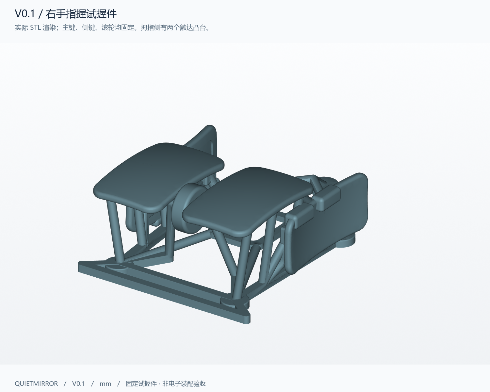

# Quietmirror Fingertip Mouse — V0.1

右手指握鼠标的一体式 FDM 试握件，**90 × 62 × 31 mm**，夹持中心目标约 **54 mm**。左右主键、两个拇指凸台、滚轮触感件、开放骨架及五个脚贴平台连接为一个实体。主键、侧键与滚轮均固定；本轮用于外形和触达测试。



这些尺寸是试握假设，没有通过实物试握。用户提供的 230 mm 近似手长与 190 mm 张开跨度只作为背景记录；190 mm 没有当成掌宽或握宽，模型没有按手长整体放大。

## 直接使用的文件

| 文件 | 用途 |
|---|---|
| [STL](exports/quietmirror_fingertip_V0.1.stl) | 打印模型，单位按 mm，100% 比例 |
| [3MF 项目](exports/quietmirror_fingertip_V0.1_PRINT.3mf) | 一个模型，脚贴面朝下，内含通用 PLA 估算配置 |
| [STEP](exports/quietmirror_fingertip_V0.1.step) | 有效的单一 B-rep 实体，供其他 CAD 编辑 |
| [参数文件](cad/parameters.json) + [CadQuery 源码](cad/build_mouse.py) | 原始可编辑参数化设计 |
| [电子包络 STEP](exports/electronic_envelopes_ESTIMATES.step) | 试握件与 16 个参考包络的装配预览，**不用于打印** |
| [设计与验证报告](reports/V0.1_设计与验证报告.md) | 尺寸、网格、薄壁、五脚共面、打印估算 |
| [电子包络与待测尺寸](reports/电子包络与装配待测.md) | 估计边界、已发现干涉、下一版所需数据 |
| [试握反馈表](reports/试握反馈表.md) | 握宽、顶掌、拖地、触达与抬鼠测试记录 |
| [上游审阅与许可](references/REFERENCE_REVIEW.md) | 实际查看的源文件、提交、参考内容及署名 |

图纸：[俯视](views/02_top.png) · [拇指侧](views/03_left_side.png) · [底视](views/04_bottom.png) · [右侧](views/05_right_side.png) · [内部包络](views/06_envelopes.png) · [尺寸图](views/07_dimensions.png) · [包络布局表](views/08_envelope_layout.png) · [真实切片截面](views/09_slice_layers.png)。

## 打印

1. 在切片器中打开打印 STL 或 3MF，确认 **X=62、Y=90、Z=31 mm 左右**、缩放 **100%**，五个脚贴安装面朝下。STL 格式本身不携带单位，按毫米解释；3MF 明确携带 millimeter 单位。
2. 切换到实际打印机配置。已提供的 3MF 是 **220 mm 平台、0.4 mm 喷嘴的通用估算项目**，并非已适配某台机器的生产文件。可另载入 [INI](slicing/PLA_0.4_0.20_ESTIMATE.ini) 核对关键设置。
3. 首轮采用 PLA、0.2 mm 层高、4 道周壁、20% 填充、5 层顶底、4 mm 外裙边。树状支撑从热床生成，重点支撑两主键底面、固定滚轮/轴、侧键凸台下缘和托边下侧。保留连续承力筋，勿把模型中的筋当作支撑剪掉。
4. 去支撑后只轻修毛刺，再粘五个等厚的 Ø7–7.5 mm 圆点脚贴。平台直径 Ø8.8 mm。脚贴厚度若为约 0.7 mm，整件离垫总高约 31.7 mm；脚贴不含在模型中。

PrusaSlicer 2.9.6 实际切片估算：本体 **18.53 g**，支撑 **13.48 g**，裙边 **0.26 g**，合计 **32.27 g PLA**，约 **4 h 11 min**。这是切片估计，尚未实物打印或称重，也不能用于评价真实点击力与回弹。

## 编辑与重建

本轮使用 Python 3.12、CadQuery 2.8.0 / OpenCascade 7.9.3。先阅读 [参数说明](cad/PARAMETERS.md)。在项目根目录运行：

```powershell
py -3.12 -m venv .venv
.\.venv\Scripts\python.exe -m pip install -r requirements.txt
.\.venv\Scripts\python.exe cad\build_mouse.py
.\.venv\Scripts\python.exe cad\validate_mouse.py
.\.venv\Scripts\python.exe cad\render_views.py
.\.venv\Scripts\python.exe cad\make_diagrams.py
```

渲染脚本在本轮 Windows 环境使用微软雅黑字体。没有 `.reference/` 上游克隆时会跳过上游预览渲染，自己的模型仍可生成。脚本不会上传仓库。重建会覆盖 `exports/` 中本项目的 V0.1 产物；若要保留已改版，请先复制参数与输出目录。

切片命令及 3MF 配置打包见 [slicing/README.md](slicing/README.md)。几何修改后应重新运行验证并重新切片，不使用旧的报告数值。

## 后续范围

目标电子架构为 PAW3950、2.4 GHz 无线 1000 Hz、左右主键、中键/滚轮、两个拇指侧键。候选供体仍按用户称呼记录为“ATK 蜻蜓 A1 Plus”；型号、传感器、PCB 轮廓与孔位均未确认。本轮没有替换型号、设计估计螺孔、装入电子件或验证无线功能。

原始设计采用 CERN-OHL-P-2.0，见 [LICENSE](LICENSE) 与 [NOTICE](NOTICE.md)。上游参考作者、许可和复用边界详见来源记录。
