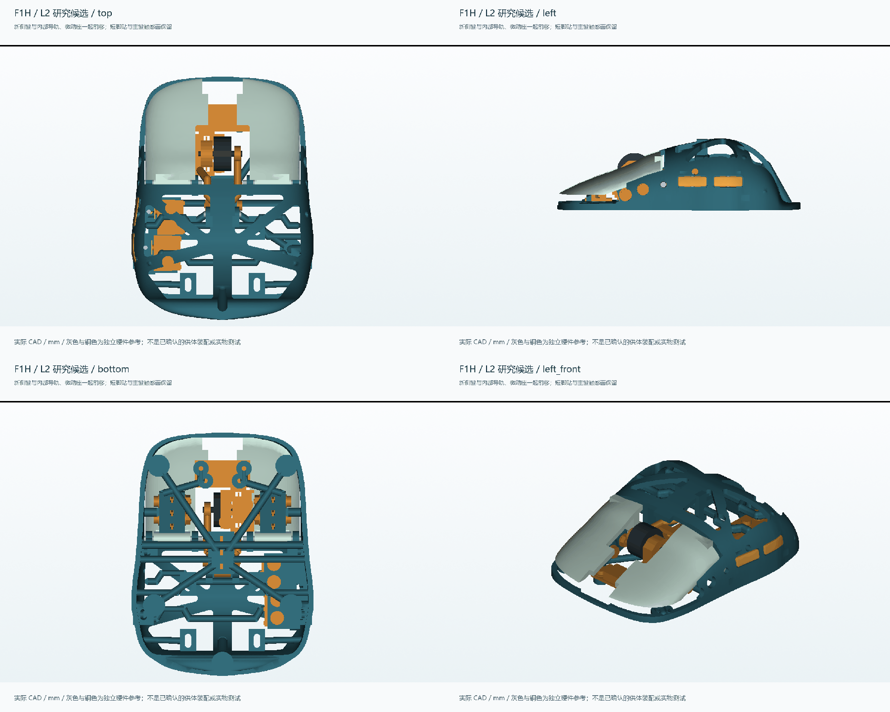

# Quietmirror R3.3 / r3_3 下载

这是此前 L2 研究成果的 R3.3 版本归档。与其他 R3 系列版本一样，模型、源码、视图、报告和切片文件均公开保存在仓库 main。原始模型内部的 F1H / L2_H_EST / L2_D_EST 编号保留用于追溯。

| 下载内容 | 共用机械版 | H 分体方案示意版 | D 供体方案示意版 |
|---|---|---|---|
| FreeCAD 完整装配 | [FCStd](FENRIR_MINISE_R3_3.FCStd) | [H FCStd](FENRIR_MINISE_R3_3_H_EST.FCStd) | [D FCStd](FENRIR_MINISE_R3_3_D_EST.FCStd) |
| 全部打印件 STL | [9 件 STL](R3_3_PRINT_STL.zip) | [11 件 STL](R3_3_H_EST_PRINT_STL.zip) | [11 件 STL](R3_3_D_EST_PRINT_STL.zip) |
| 独立零件 STEP | [STEP](R3_3_STEP.zip) | [H STEP](R3_3_H_EST_STEP.zip) | [D STEP](R3_3_D_EST_STEP.zip) |
| 完整具名装配 STEP | [装配 STEP](R3_3_FULL_ASSEMBLY_STEP.zip) | [H 装配 STEP](R3_3_H_EST_FULL_ASSEMBLY_STEP.zip) | [D 装配 STEP](R3_3_D_EST_FULL_ASSEMBLY_STEP.zip) |
| 实际切片单板 3MF | [共用拼版](FENRIR_MINISE_R3_3_PLA_PRINT_PLATE.3mf) | [H 拼版](FENRIR_MINISE_R3_3_H_EST_PLA_PRINT_PLATE.3mf) | [D 拼版](FENRIR_MINISE_R3_3_D_EST_PLA_PRINT_PLATE.3mf) |
| 完整 CAD 视图 | [共用视图](R3_3_CAD_VIEWS.zip) | [H 视图](R3_3_H_EST_CAD_VIEWS.zip) | [D 视图](R3_3_D_EST_CAD_VIEWS.zip) |

[源码 ZIP](R3_3_SOURCE.zip) · [源码说明](../../cad/rebuild_r3_3/README.md) · [两套转接件合板 3MF](R3_3_BOTH_ADAPTER_KITS_SINGLE_PLATE.3mf) · [全部验证报告](R3_3_VALIDATION_REPORTS.zip) · [设计对比图集](R3_3_DESIGN_STUDIES.zip) · [文件来源映射](R3_3_MANIFEST.json) · [43 份研究历史与 R3.2 基准](../Quietmirror-L2-Research/history/README.md)

| 方案 | 塑料件数 | PA12 理论质量 | PLA 总耗材（含支撑边框） | 切片估时 |
|---|---:|---:|---:|---|
| 共用机械版 | 9 | 18.99951 g | 37.99 g | 4h 57m 55s |
| H 示意版 | 11 | 19.74929 g | 40.55 g | 5h 17m 32s |
| D 示意版 | 11 | 19.49544 g | 39.24 g | 5h 7m 29s |
| 两套转接件合板 | 13 | 20.24522 g | 41.82 g | 5h 27m 56s |

PA12 密度假设 1.01 g/cm³；切片采用未绑定具体打印机的 250×210 mm、0.4 mm 喷嘴、0.2 mm 层高配置。图纸为毫米。合板中的两套转接件是替换方案，不能同时装入。

**原有验证边界保留：14.89 g 目标未达到，H 托架的已测试直线装入路径失败，18×18 mm 传感器板需要定制电路；D 的 ATK A1 Pro 身份和板型未核实，估计测量板仍有 17 对干涉。** 低延迟无线、1K、宏、LOD、充电与续航均未实测。完整结论见 [R3.3 报告入口](../../reports/rebuild_r3_3/README.md)。

