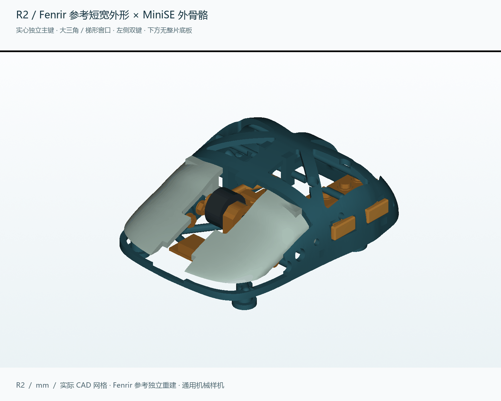
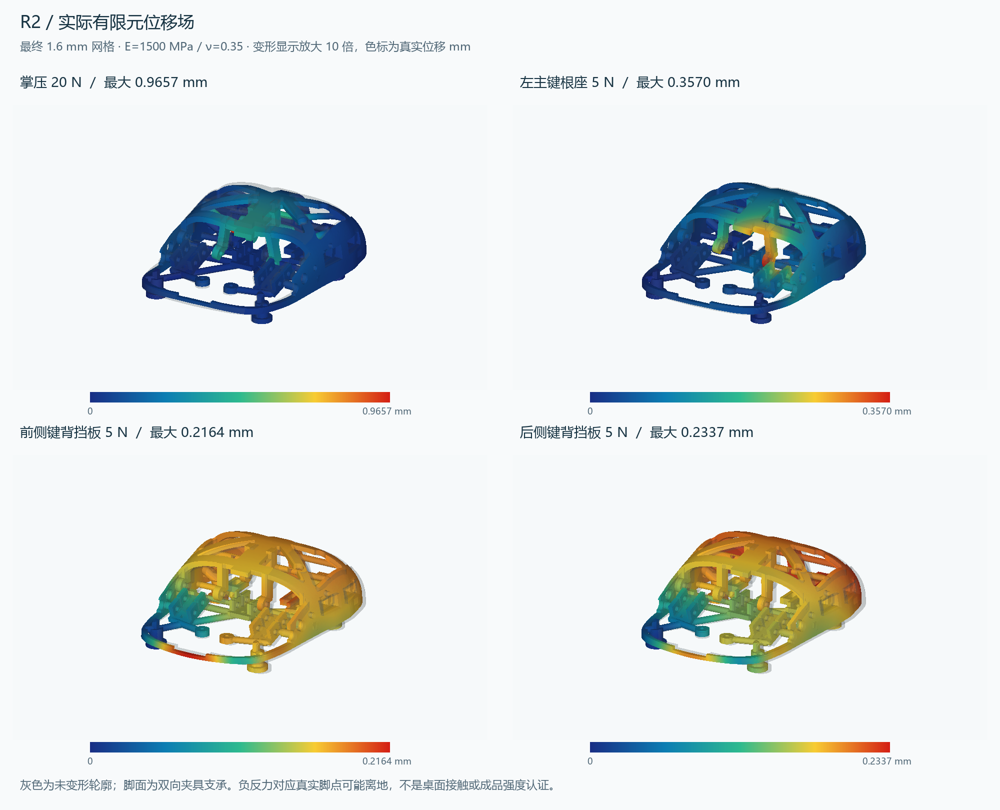

# Fenrir / MiniSE R2 机械样机

从未验收 R1 继续完成实际 CAD、分件、原生文件、切片、运动/装入检查与主壳有限元。源码与所有新工具保存在 `D:\Projects\Quietmirror`；历史 V0.1–V0.9 和 R1 保留。**这是待实物校准的机械样机，不是已完成无线电子功能或强度认证的成品鼠标。**

## 下载与编辑

- [打印 STL 包](../../releases/Fenrir-MiniSE-R2/R2_PRINT_STL.zip)：9 个分件，按毫米打印。
- [带配置打印 3MF](../../releases/Fenrir-MiniSE-R2/FENRIR_MINISE_R2_PLA_PRINT_PLATE.3mf)：已实际切片回读核对，换成自己的机器配置后重切。
- [实体 STEP 包](../../releases/Fenrir-MiniSE-R2/R2_STEP.zip)：按装配位置保存的独立实体与接口量规。
- [原生 FreeCAD](../../releases/Fenrir-MiniSE-R2/FENRIR_MINISE_R2.FCStd)：已保存并重开核对 63 个有效单实体；是可编辑 BRep，不是恢复后的草图树/已求解关节。
- [源代码与参数](../../cad/rebuild_r2/) · [复现环境](../../cad/rebuild_r2/ENVIRONMENT.md) · [装配与辅料](INSTALLATION.md) · [设计思路](DESIGN.md) · [实际参考与署名](PROVENANCE.md)。
- [R1 原始快照包](../../releases/Fenrir-MiniSE-R2/R1_07fcd46_UNACCEPTED.zip)：按原提交保存，明确未验收；[原提交](https://github.com/ht1580/Quietmirror-mouse/tree/07fcd46dc8b719804473313ddc0c5f36acd422a9)。

## 尺寸与打印

主壳实际长 × 宽 × 高：**88.236 × 66.096 × 30.564 mm**。这是 +8% 布局假设，不是人体测量验证结果。侧键和硬件可能略超出主壳包络；主壳尺寸与整套装配外包络应分开理解。

9 个塑料件的自适应 CAD 总体积为 **19.037 cm³**，按 1.24 g/cm³ 的实心体积折算约 **23.61 g**，不含硬件、电子元件、脚贴、支撑和裙边。实际 STL 体积为 19.028 cm³。默认 BRep 体积积分在裁剪 BSpline 上存在偏差，因此这里使用自适应积分，而非直接抄录默认 `cad_metrics` 体积。

PrusaSlicer 2.9.6 实际切片：**总耗材 43.99 g，约 5h 33m 1s**，含支撑等打印耗材。0.4 mm 喷嘴、0.2 mm 层高、4 壁、20% 填充、PLA 密度 1.24、210/60°C；8 项嵌入配置检查均为 True。这不是实测打印时间或成品称重。

## 几何、运动与装配证据

| 检查 | 当前结果 |
|---|---|
| 主壳 | 有效单一 CAD 实体；打印件各自独立，活动机构不熔成一块 |
| 9 个 STL | 封闭、法线一致、每件单一连通体、自相交面数为 0 |
| 五脚 | 五个平台 Ø8 mm，真实底面共面检查 True |
| 开放底部 | Z=0–5 mm 整体体积差和 20 个截面；五脚允许柱外材料 0.000000 mm³ |
| 静态 | 1953 对实体，阈值 0.01 mm³；通过 True |
| 五键运动 | 每键 31 个位置，连同相应捕获销/编码器硬件；通过 True |
| 滚轮 | 24 个转角，旋转轮体与编码器转子；通过 True |
| USB / 传感器 | USB 网格 31 位置与独立 BRep 三位置；孔槽、保留空间和光路检查 True |
| 分步装入 | 17 个阶段，每段 31 位置；通过 True；螺钉/工具柄全过程不在此路径证明内 |
| 原生文件 | FreeCAD 1.1.4 保存后重开，体积与有效性检查 True |

模型网格绝对弦差目标 0.025 mm，检测到的静态/点击候选交叠另经 BRep 核对。离散位置无相交不等于连续扫掠、零公差配合或实物不会卡滞。详情：
[网格](mesh_checks.json) · [静态/运动](mesh_assembly_checks.json) · [装入路径](insertion_checks.json) · [接口](interface_checks.json) · [五脚/尺寸](requirements_geometry.json)。

## 壁厚审计

| 打印件 | 自适应 CAD cm³ | 有限射线最短 mm | 1% 分位 mm |
|---|---:|---:|---:|
| BODY | 13.3271 | 0.045 | 0.923 |
| LEFT_KEY | 1.7804 | 0.759 | 1.313 |
| RIGHT_KEY | 1.7804 | 0.724 | 1.296 |
| SIDE_FRONT_KEY | 0.1942 | 1.000 | 1.000 |
| SIDE_FRONT_KEY_SWITCH_CLAMP | 0.1929 | 1.600 | 1.600 |
| SIDE_REAR_KEY | 0.1942 | 1.000 | 1.000 |
| SIDE_REAR_KEY_SWITCH_CLAMP | 0.1929 | 1.600 | 1.600 |
| WHEEL | 0.8238 | 1.670 | 1.670 |
| WHEEL_CARRIER | 0.5516 | 1.283 | 1.424 |

这些数字包含圆角渐薄、孔边和小止挡，**不能宣称整件处处 ≥1.6 mm**。侧键止挡宽 1 mm、轮架和轴孔附近局部低于普通壳壁目标；BODY 最短样本在边缘渐薄区域，坐标完整保留。全局最小壁厚没有被认证。详见 [完整壁厚与体积数据](thickness_volume_audit.json) 与 [设计解释](DESIGN.md)。

## 实际有限元

Gmsh 4.15.2 + CalculiX 2.22，三档直边二次四面体网格，均质各向同性线弹性。E=1500 / 2300 MPa、ν=0.35 是分析假设。解析梁基准通过，细网格弯曲误差约 1.12%。下表为最终 1.6 mm 网格、E=1500 MPa：

| 定义工况 | 最大位移 mm | 全局峰值 von Mises MPa | 有脚点负反力 |
|---|---:|---:|---|
| palm_down_20N | 0.9657 | 61.29 | False |
| left_main_root_down_5N | 0.3570 | 17.08 | True |
| side_1_switch_fence_inward_5N | 0.2164 | 15.15 | True |
| side_2_switch_fence_inward_5N | 0.2337 | 18.08 | True |

三档及最终两档位移/P95 应力收敛判定：**True**；峰值应力单独 <5% 收敛判定：**False**；合力/力矩平衡：**True**；完成时输入未变：**True**。

负脚点反力意味着该工况需要夹具拉住脚点；真实未粘接鼠标会离地，不能称为自然放在桌上仍五脚接触。报告另有 5 N 掌压及对向夹持补充工况。没有实际 PLA 批次、层间强度、螺钉承压、蠕变和疲劳允许值，因此**没有给出成品安全系数或“强度已认证”结论**。未收敛峰值不会被 P95 替代成通过结论。

[完整有限元报告](FEM_REPORT.md) · [逐档结果与反力](fem_results.json) · [解析梁基准](FEM_BEAM_BENCHMARK.md)。

## 下一轮实物与电子工作

先校准孔轴、微动预压、止挡、编码器保持与六角配合，再记录握宽、顶掌、拖地、滚轮/侧键触达和抬鼠稳定。PCB、镜头、电池、充电、电源开关、天线和固件仍待实际尺寸和测试；400–6400 DPI、无线 1 kHz、宏、LOD 与 12 h 续航尚未实现或验证。详见 [待测清单](DESIGN.md)。

原厂资料及第三方参考许可边界见 [NOTICE_R2](NOTICE_R2.md)。历史版本与当前版本不混用验收结果。
