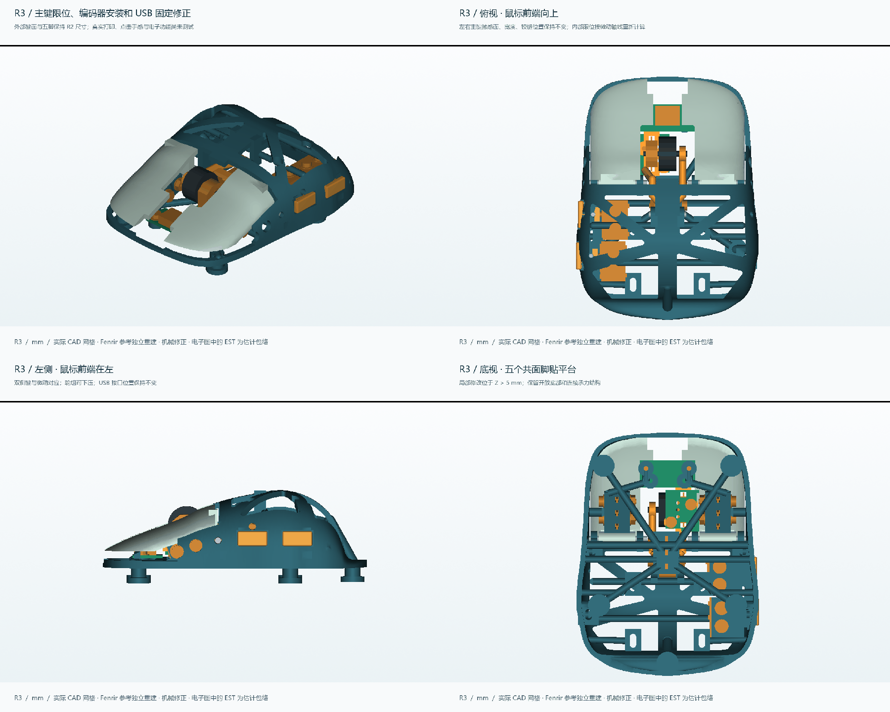
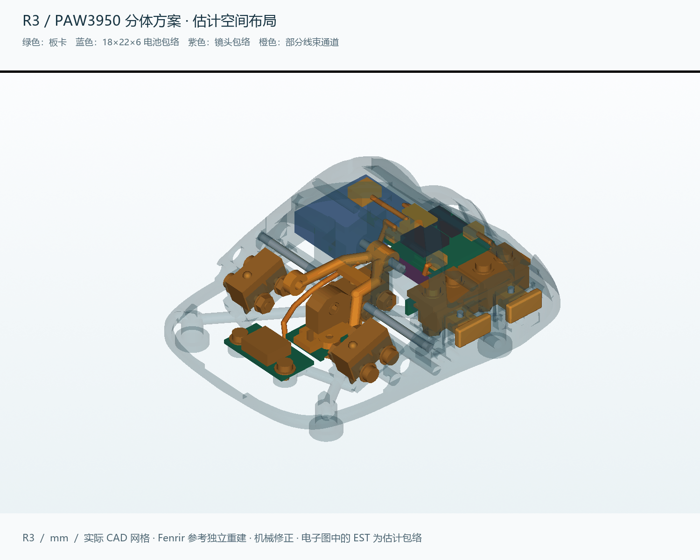

# R3：机械干涉修正与两种电子方案空间检查

**机械模型和声明的分体电子包络通过本轮几何检查；ATK 整板假设不通过。尚未确认任何实际 ATK A1 Plus 或半组装 PAW3950 主板能直接装入。** 用户本轮确认：板型尚未确定，先检查两种方案的空间和接口。

R2 和全部历史文件保留。主壳仍为 **88.236 × 66.096 × 30.564 mm**；左右主键触感面、宽度、铰链位置、五脚及 USB 接口位置保留。BODY 的 Z=0–5 mm 与 R2 精确布尔对比差异体积为 **0.000000 mm³**。

## 交付与下载

| 文件 | 用途 |
|---|---|
| [R3 打印 STL](../../releases/Fenrir-MiniSE-R3/R3_PRINT_STL.zip) | 9 个塑料分件，含本版装配和适配说明 |
| [R3 3MF](../../releases/Fenrir-MiniSE-R3/FENRIR_MINISE_R3_PLA_PRINT_PLATE.3mf) | 嵌入配置并实际切片，需按实际打印机重切 |
| [R3 STEP 与三种场景](../../releases/Fenrir-MiniSE-R3/R3_STEP.zip) | 纯机械完整模型、PAW3950 分体估计布局、ATK 不通过诊断；零件均以 mm 建模 |
| [原生 FreeCAD](../../releases/Fenrir-MiniSE-R3/FENRIR_MINISE_R3.FCStd) | 72 个有名称的机械／硬件参考 BRep，已保存并重开验证；不是有约束的动态装配 |
| [可复现源码与 R2 基准](../../releases/Fenrir-MiniSE-R3/R3_SOURCE_AND_BASE.zip) | R3 Python/JSON、依赖的 R2 源码及精确基准 STEP/STL，避免依赖原作者缓存目录 |
| [在线源文件](../../cad/rebuild_r3/) | [复现方法](../../cad/rebuild_r3/ENVIRONMENT.md)与参数 |

## 本次修正

1. **主键行程计算修正。** R2 把竖直位移当成沿倾斜微动柱的位移，原名义 0.542 mm 实际按轴线计算约 0.477 mm。保留主键本体，将固定限位从 2.3° 调到 2.8°，按本版假设自由高度得到 **0.586 mm**。中键限位从 3.8° 调到 4.1°，得到 **0.585 mm**；两个侧键为 **0.580 mm**。
2. **编码器固定补全。** 新增自定轮廓的 1.2 mm 小板、两个带导孔的载架支座、M2×3 螺钉与垫圈。板边避开中键托架及主键螺钉；新增支座后重新贯通端子孔，避免填回焊脚通道。检查包含螺钉和小板随载架下压的情况。
3. **USB 固定补全。** 接口本身不动，将假设适配板改为 20×10×1 mm，安装孔改至 X=±7.8、Y=13 mm。新增抬高支柱、桥接筋和实际螺钉头／垫圈包络，避开接口金属壳与编码器板。
4. **电子布局重排。** 保留原机构一起检查，未隐藏微动座来“制造空位”。分体板、电池、插头、开关、天线净空和五条线束通道有独立包络。旧 20×24×6 mm 电池假设未通过已检查位置；本图采用 **18×22×6 mm 候选尺寸**，含周围 0.5 mm 的预留。此改变不代表同样容量能塞进更小封装。

## 验证结果与边界

| 检查 | 实际结果 |
|---|---|
| 静态 | 98 个实体／包络，4753 对，0 个超出允许局部接触区的干涉 |
| 五键按压 | 每个 41 个位置；主键 0–2.8°、侧键 0–0.60 mm、中键 0–4.1°，通过 |
| 滚轮组合 | 0%、50%、100% 中键按压，各 24 个转角，共 72 组，通过 |
| 机械装入 | 18 个阶段、总计 930 个采样位置，通过；含编码器板与 USB 小板进入 |
| 打印网格 | 9 个均封闭、法线一致、各自单连通、无检出的自相交面 |
| 五脚与底部 | Ø8 mm 五脚底面共面，Z=0–5 mm 与 R2 保持一致 |
| 电子包络 | 21 个假设元件位于母壳外形以内；电池预留、天线净空、向下光路检查通过 |
| 原生 CAD | FreeCAD 保存并重开 72 个有效单实体；STEP 三场景也重新导入检查 |
| 切片 | PLA 44.29 g，5h 35m 21s，包含支撑与裙边 |

检查使用 0.025 mm 弦差目标的导出网格，异常相交报告阈值 0.01 mm³，候选干涉用 CAD BRep 复核。仅四组明确的螺钉／导孔啮合区和线束端点的局部接触区被作为预期接触处理；按键运动只去除微动的活动柱区域，未跳过整个微动外壳。**有限采样不是连续扫掠证明、制造公差分析或实物装配测试。** 电子安装架、全部导线和电子元件整体装入路径尚未定型。

9 个塑料件 CAD 体积约 **19.178 cm³**，按 PLA 1.24 g/cm³ 折算 **23.78 g** 实体材料；不含电子与金属件。壁厚抽样仍存在轮廓边缘短弦和约 1.26 mm 的载架局部弦，不能写成“所有位置都 ≥1.6 mm”。详见 [壁厚与体积](thickness_volume_audit.json)。R2 有限元结果只作为历史，本轮没有对修正后的 BODY 重新进行强度认证。

## 两种主板的结论

**ATK A1 Plus：当前不能放行。** 36×50×1.2 mm 只是旧假设，现位置与 BODY 约 225.71 mm³、中键微动约 1.215 mm³ 相交。R2 的有限平移／90° 转向网格共检查 780 个位置，也没有找到该矩形板的无干涉位置；这不证明真实 ATK 板所有形状和姿态都不可能。实际板形、元件高度、开关／编码器／传感器／USB／天线位置必须量到后再决定换布局或改壳。不能假设供体使用 PAW3950，也不能指导裁掉已有元件的 PCB。

**PAW3950 分体方案：声明的估计尺寸可以获得无干涉布局。** 它要求独立传感器板、控制／无线板、侧键板、编码器板和 USB 适配板，不能视为某款现成半组装板的已验证适配。安装架孔位、铜箔布线、实际插头、全部焊线、镜头工作高度与无线功能仍未验收。详见 [兼容性报告](COMPATIBILITY.md)。

[按键与装配](INSTALLATION.md) · [检查数据](validation_inputs.json) · [R2 审计原始发现](R2_missing_interface_audit.json) · [ATK 失败诊断](blocked_donor_check.json) · [来源与许可](NOTICE_R3.md)
