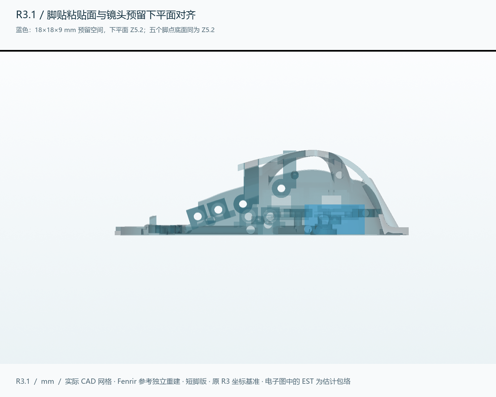

# R3.1：五个脚贴点缩短并对齐镜头预留下平面

**五个脚贴粘贴面由 R3 的 Z=0 上移至 Z=5.2 mm，缩短 5.2 mm，与实际导出的 `SENSOR_RESERVED_VOLUME` 下平面共面。** 五个 Ø8 mm 粘贴面保留，平台本体厚度为 1.6 mm；所有上部连接仍连入同一个 BODY 实体。R3、R2 与更早版本全部保留。

本轮将“预留出来的镜头水平平面”解释为**传感器／镜头预留空间的下基准面**。内部 `MATCHED_LENS_EST` 的底面仍为 Z=7.8 mm，它是尚未校准的电子包络；本次没有把这两个不同平面混为同一个真实光学面。

## 修改范围

- 只修改主壳 BODY 的五处脚点与下段支柱；其他 **71 个机械 STEP/STL** 与 R3 逐字节一致。
- 五处局部编辑区域之外，BODY 双向各 7000 个表面样本检查的最大距离为 **0.0179 mm**，在两套导出网格合计 0.055 mm 的弦差判据以内。这是有限表面检查，不是精确体积相等证明。保留主键、侧键、滚轮、微动座、USB 与主板预留位置。
- 保留 R3 装配坐标：新粘贴基准为 Z5.2，顶部仍为 Z30.564；顶部高出粘贴面 25.364 mm。主壳实际最低处为 Z5.0，因此 BODY 本体包围盒高约 25.564 mm。打印 STL 单独归零摆放，不改变装配坐标。
- STEP 回读前保留局部布尔分割面，避免合并圆柱面引起定向错误；没有使用补洞、删除网格组件或近似重建来掩盖错误。

## 离地间隙与镜头高度

**这版需要贴上脚贴使用，不能把裸塑料粘贴面直接当成鼠标垫接触面。** 原底框最低处比粘贴面低约 0.2 mm；左右微动参考件最低点约 Z5.063。

| 项目 | 本轮结果 |
|---|---|
| 示例脚贴厚度 | 0.50 mm，实际脚贴待测 |
| 示例鼠标垫平面 | Z4.70 |
| 全部静态参考件的最小离地间隙 | 0.299 mm |
| 保留至少 0.25 mm 名义间隙所需脚贴厚度 | 至少约 0.451 mm |
| 当前估计镜头底面到鼠标垫 | 3.100 mm，仅几何尺寸链 |

建议先用**实测约 0.5 mm 或更厚**的圆点脚贴试装，再检查压缩、翘曲及鼠标垫接触。公式更新为 `镜头底面到鼠标垫 = 镜头底面Z − 脚贴粘贴面Z + 实际脚贴厚度`。真实镜头的要求尚未确定，不能据当前 3.1 mm 推断 PAW3950 已可正常追踪，也不能用 LOD 软件设置代替机械高度校准。

## 本轮验证

| 检查 | 结果 |
|---|---|
| BODY | 有效单实体；五个完整 Ø8 mm 粘贴区域共面，与预留下平面差值 <0.000001 mm |
| 打印网格 | 9 个封闭、各自单连通、法线一致；无检出的自相交面 |
| 静态 | 98 个实体／包络，4753 对，0 个未允许干涉 |
| 按压／旋转 | 五个按压机构各 41 个位置；滚轮 72 组按压和旋转组合通过 |
| 机械装入 | 18 个阶段、930 个采样位置通过 |
| 地面避让 | 含按压采样，在上述 0.5 mm 脚贴假设下通过 |
| CAD 回读 | STEP 三场景有效；原生 FreeCAD 保存后重新打开并检查 |
| 切片 | PLA 37.75 g，4h 56m 29s，包含支撑和裙边 |

有限静态／运动采样不是连续扫掠证明，也不代替实物打印、公差、强度、回弹与使用寿命验证。塑料件精确 CAD 体积约 **18.527 cm³**；薄壁抽样见 [原始数据](thickness_volume_audit.json)，不作全模型最小壁厚或强度认证。

## 下载

| 文件 | 内容 |
|---|---|
| [BODY.stl](../../exports/rebuild_r3_1/print/BODY.stl) | 仅需替换的主壳；其余 8 个打印件可沿用 R3 |
| [全部打印 STL](../../releases/Fenrir-MiniSE-R3.1/R3_1_PRINT_STL.zip) | 9 个打印分件 |
| [STEP](../../releases/Fenrir-MiniSE-R3.1/R3_1_STEP.zip) | 纯机械、PAW3950 分体估计、ATK 不通过诊断三个命名场景，以及独立 BODY |
| [FreeCAD](../../releases/Fenrir-MiniSE-R3.1/FENRIR_MINISE_R3_1.FCStd) | 可编辑命名 BRep，非有约束的动态装配 |
| [3MF](../../releases/Fenrir-MiniSE-R3.1/FENRIR_MINISE_R3_1_PLA_PRINT_PLATE.3mf) | 已实际切片的通用 PLA 排版，仍需按实际机器重切 |
| [源码修订层](../../releases/Fenrir-MiniSE-R3.1/R3_1_SOURCE.zip) | Python/JSON 与依赖代码；几何基准使用保留的 R3 源码包，见 [复现方法](../../cad/rebuild_r3_1/ENVIRONMENT.md) |

打印仍按 0.4 mm 喷嘴、0.2 mm 层高、4 道壁、20% 填充、全区域支撑估算。BODY 按实际最低点放到热床；脚贴粘贴面比该最低点高 0.2 mm。本轮已从实际 G-code 核对五个粘贴面下方均有首层支撑挤出路径，见 [首层支撑检查](first_layer_support_checks.json)；这不等于实物粘附或全覆盖承托已验证。去除支撑后检查五脚平整，再贴脚贴；不可直接发送本项目通用配置到未核对的打印机。

## 电子与历史边界

本次未改电子布局。ATK A1 Plus 真实板未测，历史矩形板假设仍是不可装入的诊断场景；PAW3950 分体方案仍是估计包络。电池容量、实际镜头、板卡孔位、完整走线、无线 1K 与 12 小时续航都未因缩短脚点而得到确认。[R3 兼容性说明](../rebuild_r3/COMPATIBILITY.md)与[机械安装顺序](../rebuild_r3/INSTALLATION.md)继续适用，但涉及旧脚贴平面、外高和旧切片用量时以本报告为准。

[R3 原首页](../../README_R3.md) · [R3 报告](../rebuild_r3/README.md) · [R3.1 来源与许可](NOTICE_R3_1.md)
