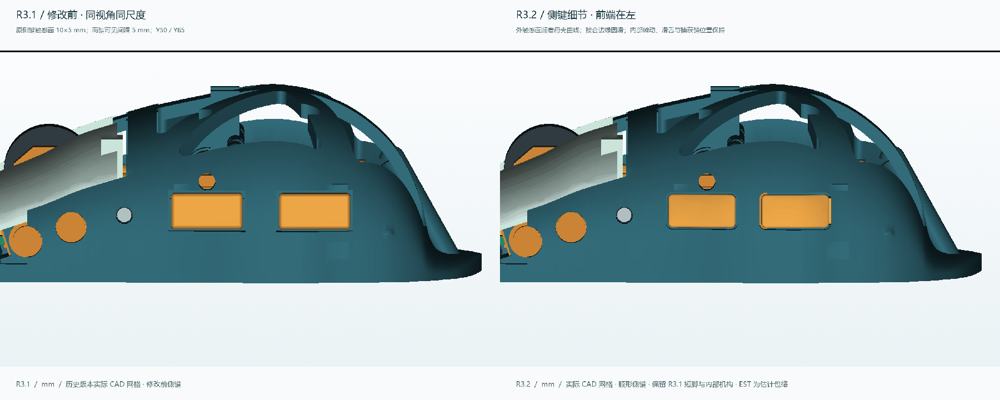
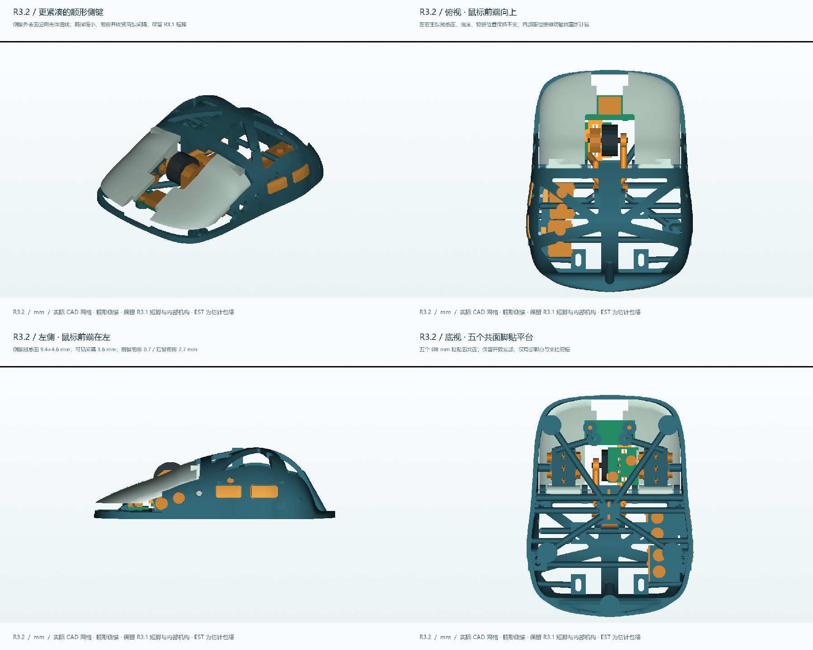

# R3.2：更顺着壳体线条的紧凑侧键

两个侧键改用母壳曲面作为触感面，略微缩小并向前移动，缩小两键可见间隔。外形与内部连接同时修改；需替换 **BODY、SIDE_FRONT_KEY、SIDE_REAR_KEY 三个打印件**。其余 6 个打印件与 R3.1 相同。历史版本全部保留。

## 几何改动与理由

坐标单位 mm，Y 越小越靠前，X 正向为使用者左侧。下列长度和高度指**外侧可见触感面**，不包含隐藏滑舌、止挡与捕获销。

| 项目 | R3.1 | R3.2 |
|---|---:|---:|
| 每个侧键触感面长度 | 10.0 | 9.4，缩短 6% |
| 触感面高度 | 5.0 | 4.6，降低 8% |
| 前侧键中心 Y | 50.0 | 49.3，前移 0.7 |
| 后侧键中心 Y | 65.0 | 62.3，前移 2.7 |
| 两键中心间距 | 15.0 | 13.0 |
| 两键触感面之间的 Y 向间隔 | 5.0 | 3.6，缩小 28% |

触感面直接取自项目原有母壳的连续曲面，沿 X 向外偏置 0.45 mm，因此随侧壁曲率变化；这不是整个键帽做成一个外凸平板。平面轮廓圆角 R0.65，外触摸棱线 R0.25，开口轮廓留 0.30 mm 名义间隙。真实打印公差仍需用小样校准。

把两套微动一起靠拢会挤占原安装座空间，所以保持微动、捕获销、滑舌导向、焊脚和侧键板的位置，仅调整外侧触感面与其连接。内部 5.2×3.4 mm 滑舌及原触点位置保留；每键保留原前侧压缩止挡，移除会露出尾巴的旧键帽和后侧止挡。偏置按压由键帽连接区、滑舌和捕获销传力，尚未进行实物刚度、疲劳或卡滞试验。

设计滑动行程仍为 **0.60 mm**；按现有 0.02 mm 假设空隙，微动轴向名义压入为 **0.58 mm**。这不是实测点击力、动作位置或安全超行程。实购微动的自由高度、动作点、总行程和 FDM 摩擦仍需校准。

## 保留范围

- R3.1 五个 Ø8 mm 脚贴粘贴面仍为 **Z5.2**，与镜头预留空间下平面共面；平台厚 1.6 mm。
- 其余 **69 个机械零件 STEP/STL 与 R3.1 逐字节一致**，包括主键、滚轮、捕获销、微动参考、夹条及硬件。
- 壳体侧键编辑区域之外，双向各 7000 个表面抽样的最大距离为 **0.0156 mm**，在 0.055 mm 判据内。此判据含两次 0.025 mm 导出弦差，不是全局精确几何相等的证明。
- 原壳的 STEP 曲面在直接布尔修改时出现错误分类，因而从原参数源重建开口，再重放原 R3 内部修正与 R3.1 缩脚步骤；没有通过补洞、删除碎片或网格近似来掩盖失败。
- 旧后键开口角部遗留约 0.203 mm³ 封闭小空腔，已在 CAD 层填实；该空腔不属于滑舌通道。具体边界记在 [修改记录](change_scope.json)。

## 本轮验证

| 检查 | 实际结果 |
|---|---|
| STL | 9 个打印件均封闭、各自单连通、绕向一致；无检出的自相交面 |
| 静态 | 98 个实体／估计包络，4753 对，0 个未允许干涉 |
| 按压 | 左右键、两个侧键及中键机构，各 41 个位置通过 |
| 轮转 | 72 组按压与轮转组合通过 |
| 装入 | 18 阶段、1101 个采样位置通过 |
| STEP / FreeCAD | 3 个 STEP 场景回读有效；72 个 FreeCAD 实体保存、重新打开有效 |
| 体积 | 9 个塑料件精确 CAD 自适应积分合计约 18.507 cm³ |
| 实际切片 | PLA **37.69 g / 4h 54m 57s**，包含支撑、裙边 |

以上是有限采样和文件几何验证，不等于连续运动扫掠或实物装配认证。壁厚射线抽样见 [原始数据](thickness_volume_audit.json)，不作全局最薄壁或强度保证。侧键外观与触达仍需试握反馈。

## 下载、打印与更换

- [三个更新件](../../exports/rebuild_r3_2/print/)：BODY、SIDE_FRONT_KEY、SIDE_REAR_KEY。
- [全部 9 件 STL](../../releases/Fenrir-MiniSE-R3.2/R3_2_PRINT_STL.zip)。
- [三场景 STEP 与独立修改件](../../releases/Fenrir-MiniSE-R3.2/R3_2_STEP.zip)：纯机械、PAW3950 分体估计、ATK 不通过诊断。
- [FreeCAD](../../releases/Fenrir-MiniSE-R3.2/FENRIR_MINISE_R3_2.FCStd)：可编辑命名 BRep，非有约束的动态装配树。
- [3MF](../../releases/Fenrir-MiniSE-R3.2/FENRIR_MINISE_R3_2_PLA_PRINT_PLATE.3mf)：实际切片的通用 PLA 排版，按自己的打印机重切。
- [参数与生成源码](../../cad/rebuild_r3_2/) / [源码包](../../releases/Fenrir-MiniSE-R3.2/R3_2_SOURCE.zip) / [复现步骤](../../cad/rebuild_r3_2/ENVIRONMENT.md)。

打印参数沿用 0.4 mm 喷嘴、0.2 mm 层高、4 壁、20% 填充、全区域支撑。主壳底部朝下，侧键按 PRINT STL 朝向放置；清理键帽底缘、滑舌、孔位及安装座支撑，避免强行拔压。先装微动与夹条，再插入键帽并装捕获销。**后侧键应先向鼠标前方偏置约 0.30 mm，从左侧插到位，再回移 0.30 mm，最后装捕获销。** 直接水平直插会碰到新开口后缘；偏置路径按每段 101 个位置检查通过，实际 FDM 公差和插入力仍需试装。其余按 [原安装顺序](../rebuild_r3/INSTALLATION.md)，尺寸与耗材估计以本报告为准。

五脚下方首层支撑路径已从本轮 G-code 检查。按实测 0.50 mm 脚贴示例，最低离地间隙约 **0.299 mm**；裸壳底框低于粘贴面约 0.20 mm。镜头真实工作高度尚未验证，不能据此认定传感器已经适配。

## 电子与下一轮反馈

ATK A1 Plus 仍无实测板型，保留的是不能装入当前机构的历史矩形包络诊断。PAW3950 分体方案仍为估计空间与接口。实际板卡、镜头、电池容量、完整走线、无线 1K、宏、LOD 与 12 小时续航没有新增实物验证。见 [R3 兼容性边界](../rebuild_r3/COMPATIBILITY.md)。

建议试握重点：拇指自然落点能否区分两键、后键是否还偏后、快速切换是否误触、按前端与后端是否卡滞、抬鼠时是否误按；同时记录回弹、空行程和贴合公差。

[R3.1 原首页](../../README_R3_1.md) · [R3.1 报告](../rebuild_r3_1/README.md) · [历史记录](../../HISTORY_R3_2.md) · [许可与署名](NOTICE_R3_2.md)
