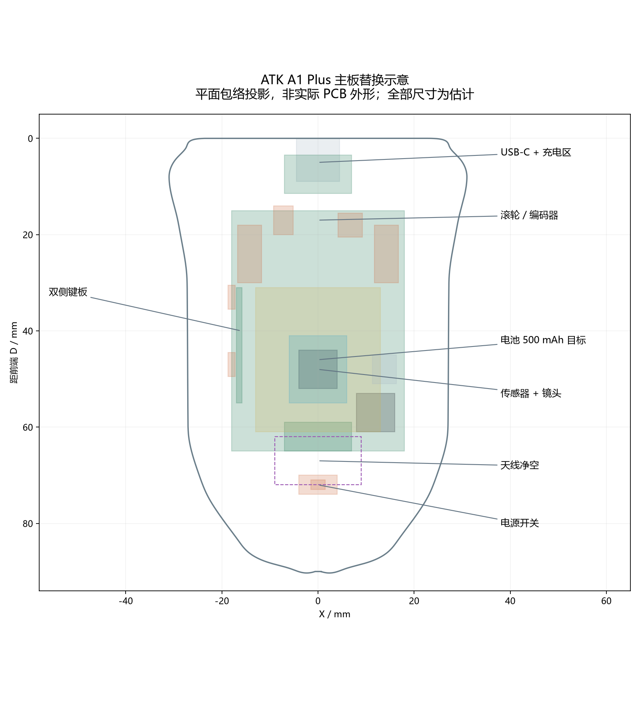
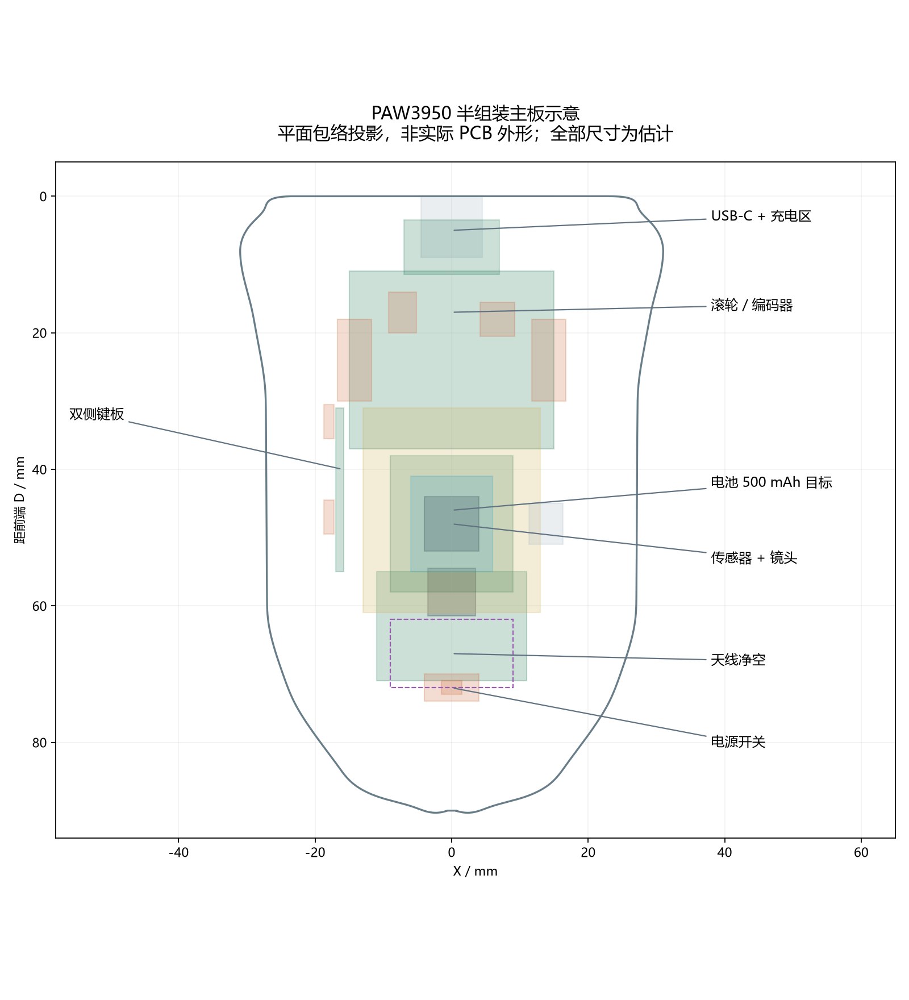

# V0.6 · 两种主板方案与功能实现条件

本轮交付的是**电子装配示意模型**：有独立主板、传感器与镜头、滚轮、编码器、中键、两主键开关、侧键板、电池、插头、线束、USB-C、充电区、电源开关和天线净空。所有电子尺寸与摆位均为估计；没有声称买来零件即可装配，更没有交付能运行的电路或固件。

用户所称 **ATK A1 Plus** 保留原名，具体型号、传感器版本和主板外形待确认。未用 F1、A9、Z1 或其他型号的参数替代它。PAW3950 只指传感器，不规定主板尺寸，也不单独提供无线 1K、宏或充电功能。

## 三个模型的区别

1. **FIT**：一个连续可打印实体。主键、两侧键和滚轮固定，用于握持、触达和抬鼠检查。USB-C 孔和底部开关孔已经加入。
2. **ATK_A1_PLUS_ESTIMATED**：共同外壳 + 可分离侧键 + 估计供体主板及组件。移除了 FIT 固定滚轮、支架和侧键固定桥，展示真实滚轮/编码器的空间。主键仍然是固定试握面，点击机构还未设计。
3. **PAW3950_CUSTOM_ESTIMATED**：共同外壳 + 可分离侧键 + 主控板、传感器板、RF 区域分布式示意。不是已完成电路设计的 PCB。

电子版 STEP 中每个物体有独立名称和颜色；`VIEW_ONLY.3mf` 是多对象观察场景，不能当成整件打印。`CLEARANCES.step` 只含净空预留，不能当实体零件一起打印。独立部件 STL 用于查看和再建模，文件名全部保留 EST 标志。

## 功能目标与两条实现路线

| 要求 | ATK A1 Plus 主板替换 | PAW3950 半组装自主板 | 后续验收 |
|---|---|---|---|
| 400–6400 DPI | 保留原板驱动/固件；需确认能配置此范围 | 固件开放 400–6400 范围，并按实际传感器支持的步进配置 | 设置端点及中间值，断电后读回；测量计数/距离 |
| 无任何 sync 技术 | 确认 Motion Sync 等可选同步增强可关闭且断电记忆；关闭不了则不满足本要求 | 不启用 Motion Sync 等可选跟踪同步增强，配置默认关闭 | 配置读回、断电复测、固件审查；不把普通无线协议时序也称作需要移除的 sync |
| 无线 1000 Hz | 原板、原固件与原匹配接收器共同支持 | 主控/2.4 GHz 链路/固件/匹配 USB 接收器整链实现 | 持续运动记录报告间隔分布与丢包，不能只看设置界面显示 1K |
| 低延迟无线 | 原板及接收器的能力；壳体不能降低固件队列延迟 | 低延迟扫描、事件队列、射频调度和接收器 USB 输出 | 实测点击到报告、运动到报告的分布；本轮不虚构 ms 指标 |
| 宏 | 原驱动是否支持、是否可写板载存储待确认 | 按键映射、宏编辑/触发/停止、持久化设置；避免宏阻塞输入扫描 | 主键/侧键映射、宏时序、终止机制与掉电保持；无主机软件时能否运行另测 |
| LOD | 确认原固件公开对应设置且实际镜头匹配 | 按真实 PAW3950+镜头资料开放支持的 LOD 档位，不虚构任意高度 | 在真实脚贴、底面、镜头和垫面上测离面停报/恢复高度 |
| 左右键、滚轮、中键、双侧键 | 原开关布局可能需要保留或重做子板；不可假设都能飞线搬位 | 主控读取 5 个按键及滚轮编码器，设计去抖和中键行程 | 全部输入、侧键回弹、滚轮刻度/方向与中键分别测试 |
| 电源开关 | 保留原电源逻辑，开关搬位与引脚需实测 | 物理开关控制系统电源/使能；充电路径是否保留按实际方案实现 | 关机静态耗电、充电状态、上电和掉电行为 |
| USB-C 充电 | 优先保留供体原充电管理与电池匹配，不重复串接第二个充电器 | USB-C 输入识别、限流/保护、单节锂电充电、电源路径管理和受保护电池 | 插拔、充电电流、满充终止、温升、低电压关机；不能仅接插座到电池 |
| 满性能连续使用 ≥12 h | 取决于供体实测电流及能装下的实际电池 | 依照下面功耗预算选择实际电池并验证 | 无线 1K、持续运动与按键、所需最高性能设置，不把睡眠或待机算入 |

“无 sync”在本轮按**关闭 Motion Sync 及同类可选跟踪同步增强**理解，基本 USB 与无线协议必须的时序仍然存在。宏与设置优先按可保存到设备的目标考虑，但供体能否做到尚未核实。

如果供体固件不提供某项功能，换壳和空间预留不会补出该功能。此时应更换符合目标的板/固件方案，或采用自主板路线；不会把不满足条件的供体写成已满足。

## 电源与续航预算

- 电池目标：**500 mAh**；初始包络 **26 × 30 × 6 mm**。容量目标和几何包络是两项独立假设，尚未找到或测量一个同时满足二者的电池。
- 预算有效容量取标称的 **75%**，作为电压截止、转换损耗、容量偏差及老化余量的保守合并预算，不能替代实际电池放电曲线。
- 持续平均电池电流目标 **≤30 mA**：`500 × 0.75 ÷ 30 = 12.5 h`。
- 达到 12 h 的预算上限是 **31.25 mA**。若实际为 40 mA，预算仅 **9.38 h**，至少需 `40 × 12 ÷ 0.75 = 640 mAh` 的标称容量，再重新检查体积与重量。
- RF 发射、电源启动和充电时的峰值电流与持续平均电流分开核对；不能仅按 30 mA 选择电源器件。
- 充电电流、充电时间、工作温升和电池允许倍率不设伪造数值，待真实电池与充电电路确定。LED 默认关闭可减少预算消耗，但不通过降低报告率或进入空闲睡眠来满足“满性能”要求。

**当前没有实测续航，不承诺已达到 12 小时。** 此处明确给出的是可检验的容量/电流约束。

## 机械布局与实际限制

公共外壳外形约 90×62×28 mm，侧键仍在左侧；内部电子排列可以因方案不同而不对称。外观“除侧键外镜像”不要求真实 PCB 的芯片、编码器和插头也镜像复制。

USB-C 入口位于前端中轴，估计开孔 **13.4×6.4 mm，R1.8，中心 Z=7.1 mm**。模型还预留外侧插头插拔包络；真实插头胶壳、焊脚、固定方式和防拉脱需要实测。底部开关开孔 **6×3 mm**，位于中轴、距前端 72 mm；开关体和操作行程均为示意。

传感器光轴沿 Z、垂直垫面。镜头中心示意高度 Z=6.7 mm，不是光学装配尺寸。实际高度必须沿“传感器封装基准 → PCB → 镜头定位面 → 壳底 → 脚贴胶层/磨损 → 垫面”建立尺寸链，使用真实镜头所需工作距离；不能照抄 PAW3395 或其他板的高度。

没有创建估计安装孔。当前是空间布局，需要后续添加根据实板设计的卡座/托架/螺柱或固定方式。五脚与承力筋不是主板孔位。侧键子板、供体 USB 和开关的独立搬位均为条件性布局假设，原板如果无法拆分，需要改变板型、位置或壳体，而非强行剪板。

两种主板示意的前端都画了 **8.4 mm 宽的滚轮避让缺口**，以避开降低后的滚轮。这是估计板形的一项条件，不是从 ATK 实板测得，也不是要求裁剪真实主板。供体原 PCB 若没有相应空间，必须调整轮轴/板位置或壳体尺寸。电池后移到 D46 mm，为主键开关与电池服务净空留间距；左右主键行程分别预留小区域，未用一个横跨滚轮与电池的大方块冒充可用机构空间。

底部与顶部接触面保持同一套几何。电子示意版删除了纯试握件的固定滚轮支架，但没有添加完整的工作滚轮支撑和主键弹性机构；这两条受力路径必须在下一轮装配设计中建立。外壳目前也未拆成可锁合的上下盖，不能把从底部能看到零件误认为安装、维修路径已验证。

碰撞检查使用实际保存的 CAD 组件，并区分物理组件、允许的轴连接和净空预留。结果与未解决项见 [装配检查结论](ASSEMBLY_CHECKS.md)、[ATK 原始数据](ATK_A1_PLUS_layout.json)、[PAW3950 原始数据](PAW3950_CUSTOM_layout.json)。没有进行 PCB 电气规则检查、固件运行、RF 仿真或实物试装。

## 建议用外部 CAD 继续搭建

**推荐在进入真实装配阶段使用 FreeCAD。** 本轮 CadQuery 参数源负责稳定地生成和比较版本；导出的 STEP 适合在 FreeCAD 中摆放实测主板、约束零件并设计卡座、螺柱和按键机构。STEP 导入后通常是几何实体，不会自动恢复本项目所有参数和建模历史，所以应保留 JSON/Python 作为外壳的参数源，修改外形后重新导出，再替换装配中的对应零件。

也可使用你已经熟悉的商业参数化 CAD；本项目以毫米 STEP 作为交换格式。没有必要为了这轮示意图立即购买软件。Blender 适合渲染和外形雕刻，精确孔位、光学高度链与装配公差更适合在参数化 CAD 中完成。本轮未安装或启动 FreeCAD，已经提供可导入的 STEP。

建议下一步顺序：实测供体/板件 → 导入或重建真实包络 → 先锁传感器与镜头高度 → 固定滚轮和主键轴线 → 布局电池/天线/USB → 定义上下盖与紧固 → 检查完整装入路径 → 打印局部接口样块 → 再做完整装配壳。

## 后续最低待测清单

1. ATK 完整型号、PCB 照片/长宽厚、边界、两面元件最高点、传感器中心相对 PCB 边缘、所有真实固定孔；确认传感器标识，不能假定 PAW3950。
2. 真实 PAW3950 板与镜头组件尺寸/基准、要求的工作距离、供电/接口资料和固件支持。
3. 滚轮直径/宽度、轴截面/轴长、编码器轴高、支点、中键行程、开关与按键触点高度。
4. 两侧键开关类型、受力方向、行程、键帽/导向间隙和复位方式；原子板是否存在、是否可以搬位。
5. 电池实测外形、引线、插头极性、容量、放电曲线与允许充电电流；实际满性能平均/峰值电流。
6. USB-C 本体、插头胶壳、焊盘和固定方案；电源开关本体、滑块方向及可触达范围。
7. 天线位置及厂家要求的金属/电池/走线禁布区；同接收器的配对、报告率、延迟、丢包、宏和设置持久化测试。

## 本轮采用的公开技术依据

仅用于架构与后续工具选择，不表示已选定这些芯片或实现成品：

- [Nordic nRF52840 官方规格](https://docs.nordicsemi.com/r/bundle/ps_nrf52840/page/keyfeatures_html5.html)：存在支持 proprietary 2.4 GHz、USB、SPI 的主控架构，1K 与低延迟仍需固件和接收器共同实现。
- [TI BQ24074 官方资料](https://www.ti.com/product/BQ24074)：单节锂电充电与电源路径管理的示例类别，用于说明“充电管理”和“系统供电”需要一起设计；未将该型号定为最终 BOM。
- [FreeCAD 官方 Assembly Workbench 文档](https://github.com/FreeCAD/FreeCAD-documentation/blob/main/wiki/Assembly_Workbench.md)：后续多零件约束和装配工作流参考。

未复制上述厂商 PCB、芯片封装 CAD、驱动源码或固件。原鼠标开源参考的审阅和许可证仍在 [references](../../references/REFERENCE_REVIEW.md) 与 [NOTICE](../../NOTICE.md)。
