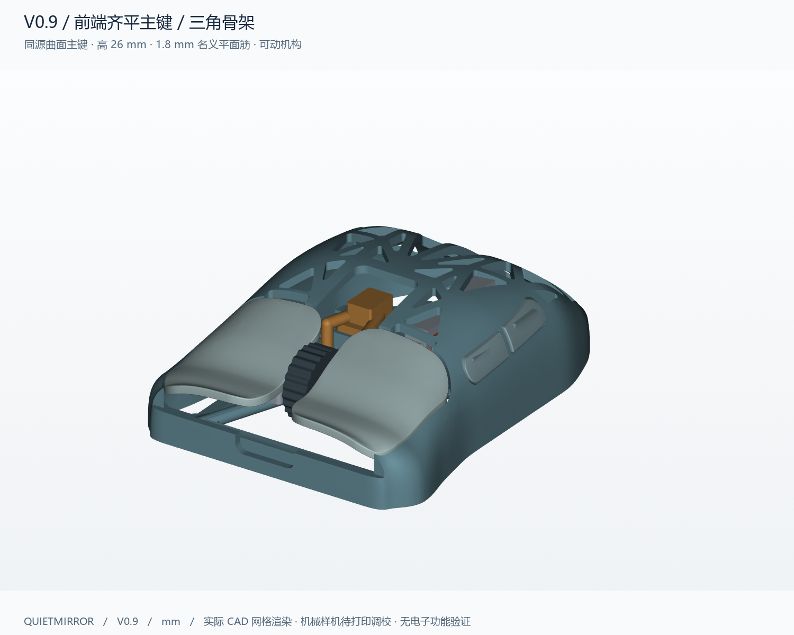
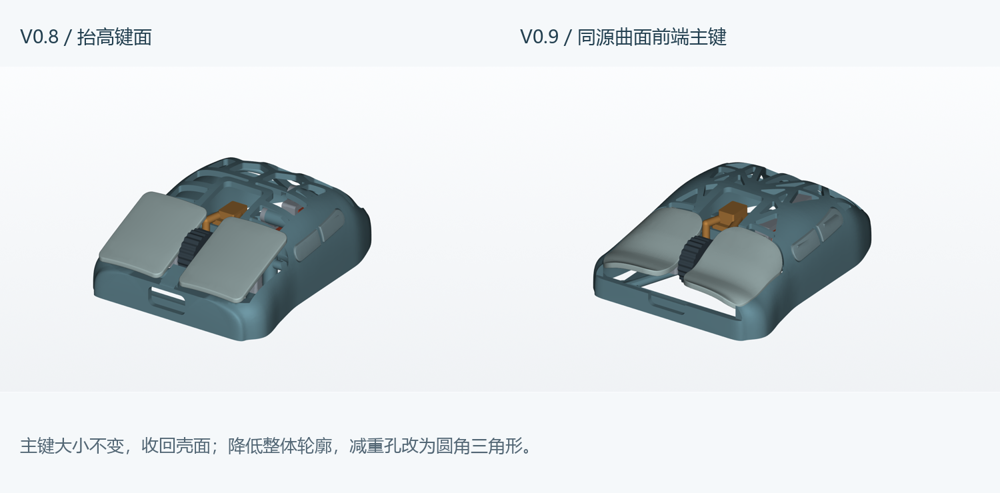
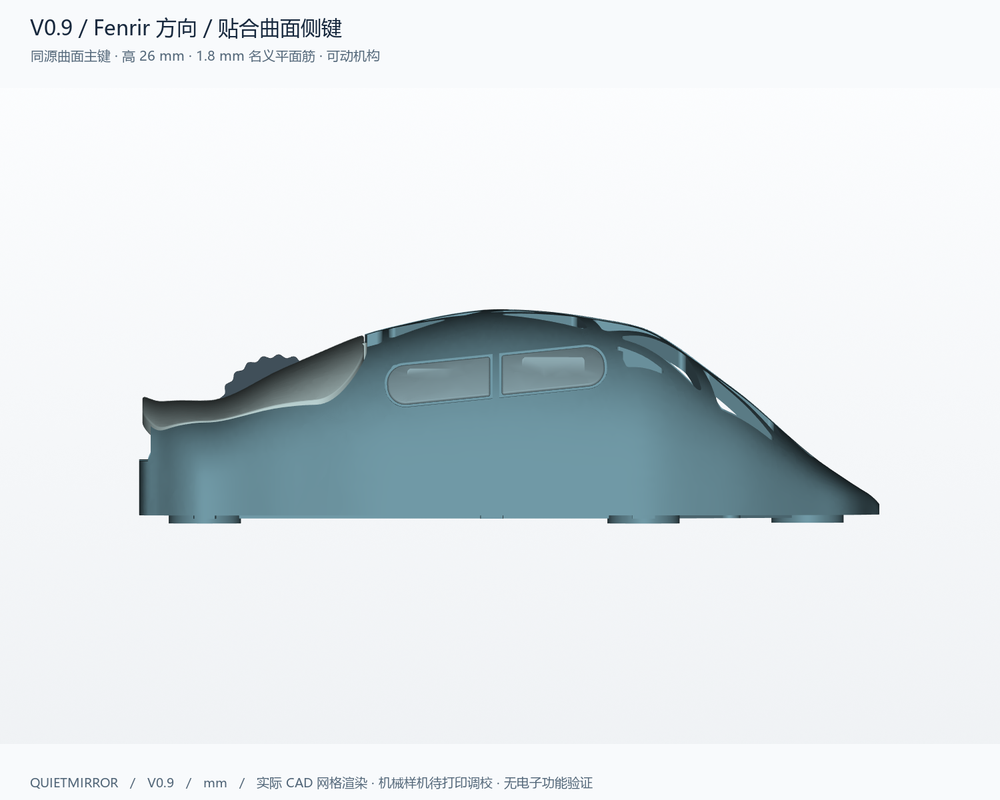
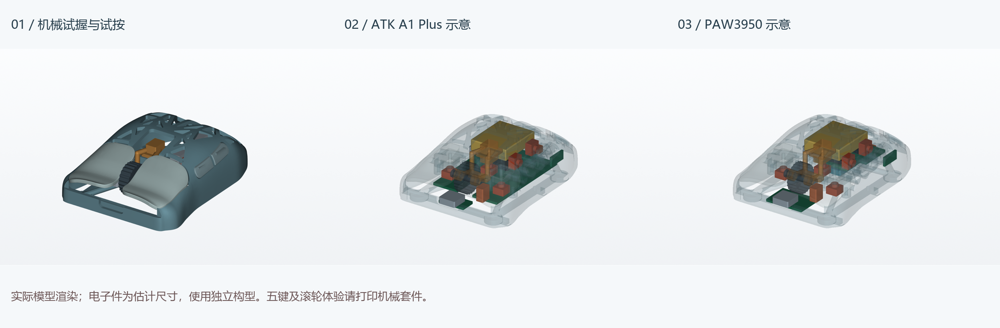

# Quietmirror · 右手指握鼠标

**当前 V0.9：同源曲面前端主键，降低整体轮廓并改用镜像三角减重孔。机械试按版与两种电子示意版同步更新，V0.1–V0.8 全部保留。**

**[完整项目 ZIP，包含所有历史版本](https://github.com/Quietmirror/github/archive/refs/heads/main.zip)** · [历史版本](../../HISTORY.md) · [装配与打印](../../reports/v09/ASSEMBLY.md) · [电子空间与未完成项](../../reports/v09/ELECTRONICS.md)

## 这次改动

| 部位 | V0.9 的具体处理 |
|---|---|
| 主键 | **23×27 mm 不变**。直接用母壳外表面分割出前端键面；取消独立抬高曲面，键尾与壳面顺接。平面角圆角由 R2.5 改为 R6，让前沿随窄鼻部收拢，最大宽和总长不变 |
| 高度与壁厚 | 名义高 **28→26 mm**；普通壳壁 **1.8→1.6 mm**。前段重新顺接，非整只鼠标沿 Z 缩放；底框、螺柱、承力筋及滑动配合单独保留 |
| 镂空 | **28 个镜像圆角三角形刀具轮廓**，三条主要直边；名义平面筋 **2.2→1.8 mm**。握持区、导向根部、三筋交汇处保留较宽材料 |
| 前沿 | 前端框架退至 Z=7.6 mm；下压0.4 mm后，D≤2 mm键尖距壳体 **0.400 mm**。原USB上方孤立横片改成向滚轮槽连通的开放式前喉口，避免悬空碎件 |
| 侧键 | 保留Fenrir方向的贴壳双侧键及D36.5/50.5位置，外凸名义0.35 mm；随新的母曲面更新 |
| 原底部 | 保留V0.8底部承力框架、五脚、传感器区和开关接口；低处侧壁随1.6 mm新母壳重建，消除新旧曲面重叠 |

**三角化范围是上壳减重窗口**。原底部开放框架、按键接缝、滚轮安装口、USB-C、开关及传感器孔属于保留结构或功能开口。孔数是刀具轮廓数；与安装口合并的区域不能算完全独立的封闭三角孔。

机身名义长90、最大宽62、握宽54、高26 mm，是试握假设。230 mm手长和190 mm张开跨度没有被当成掌宽，也没有据此等比放大。

## 下载三个版本

三个完整装配STEP分别保存在对应ZIP中，解压得到同名STEP。ZIP是原始实体的无损打包，不是网格转STEP。分件STL和较小STEP仍可单独下载。BODY的原始实体另在 **[BODY_STEP.zip](../../exports/v09/quietmirror_V0.9_BODY_STEP.zip)**，解压即得到BODY.step；校验脚本和导入宏会按需恢复到placed和print目录。

| 版本 | 下载 | 当前用途 |
|---|---|---|
| **完整机械试握/试按套件** | **[打印 3MF](../../exports/v09/quietmirror_V0.9_PRINT_PLATE.3mf)** · **[20 个打印分件](../../exports/v09/print/)** · [装配 STEP ZIP](../../exports/v09/quietmirror_V0.9_MECHANICAL_ASSEMBLY.zip) · [观察 3MF](../../exports/v09/quietmirror_V0.9_MECHANICAL_VIEW_ONLY.3mf) | 打印后另装五枚示例轻触开关，试验五键点击/回位；轮体可转、支架可下压。没有实物测试 |
| **ATK A1 Plus 估计布局** | [STEP ZIP](../../exports/v09/quietmirror_V0.9_ATK_A1_PLUS_ESTIMATED.zip) · [观察 3MF](../../exports/v09/quietmirror_V0.9_ATK_A1_PLUS_VIEW_ONLY.3mf) · [净空 STEP](../../exports/v09/quietmirror_V0.9_ATK_A1_PLUS_CLEARANCES.step) | 未取得真实供体 CAD；估计板包络保留 36×50×1.2 mm，重排高度和周边部件以避让 |
| **PAW3950 半组装板估计布局** | [STEP ZIP](../../exports/v09/quietmirror_V0.9_PAW3950_CUSTOM_ESTIMATED.zip) · [观察 3MF](../../exports/v09/quietmirror_V0.9_PAW3950_CUSTOM_VIEW_ONLY.3mf) · [净空 STEP](../../exports/v09/quietmirror_V0.9_PAW3950_CUSTOM_CLEARANCES.step) | 分板空间目标，尚无电路、正式安装结构或固件 |

**电子场景是单独配置：移除 5 个试按托架、5 个挡片和 1 个弹片，明确预留给正式电子安装结构。** 这些 11 个机械试验件仍在完整打印套件中。电子场景内剩余 9 个塑料件、5 个开关位置示例及 13 个电子包络，已检查它们之间的静态和采样行程干涉；正式 PCB/开关固定、编码器与轮轴的连接尚未设计，不能把示意配置直接当成可装电子的成品。

只有 **PRINT_PLATE.3mf / print/** 用于打印。`placed/` 和 `VIEW_ONLY` 保留装配位置，含非打印硬件；`CLEARANCES` 是预留空间。[先打印校准件](../../exports/v09/calibration/)。

## 检查结果及证据边界

滚轮下横梁最终为11×4.2×2 mm、中心D26.9 mm，较上一轮校验形状只减少17.6 mm³材料；新支架无新增材料，已验证其为原支架的子集。底框与新侧壁交界处恢复原始五个平台，补回约3.006 mm³材料；新增材料均在Z≤2.4 mm，低于所有机械件的保守运动范围，并单独检查两种电子包络。详见[支架修正证据](../../reports/v09/carrier_revision.json)和[平台恢复检查](../../reports/v09/platform_restoration.json)。

侧键托架的双螺钉固定点改到局部坐标(-6,-3.4)/(-6,3.4) mm，均位于按键下方，避免降低壳高后螺钉耳露出壳面；外侧侧键位置不变。滚轮架下横梁向后让出轮体旋转包络。

| 检查 | 保存产物的实际结果 |
|---|---|
| 20 个塑料件 | 每件 CAD 有效且单实体；STL 单连通、封闭、法线一致，自相交面数 0 |
| 静态相交 | 20 个塑料件两两检查，未发现超过 0.01 mm³ 的体积相交；另检查五个开关示例的静止配合 |
| 五键行程 | 每键 9 个位置，共 45 个位置，0–0.4 mm 内未发现超过阈值的刚性穿插 |
| 侧键与主键 | 活动组纵向区间至少间隔 **0.635 mm**；主键沿 Z、侧键沿 X 运动不会缩小该纵向间隔 |
| 装入次序 | 先预装滚轮组，再装左键、右键、前侧键、后侧键；滚轮组最终版本31点重查通过，其余4条路径各31点先对更大支架通过，再用实体包含关系确认缩短后仍通过 |
| 滚轮旋转 | 连续圆环外包络 Ø15 / 内孔 Ø3.5 / 宽5.2 mm 与固定件及弹片无刚性相交，另检查 3 个旋转相位 |
| 弹片 | 默认与齿峰外包络留 0.05 mm 名义间隙；段落感需实物调预压，未做弹性或寿命仿真 |
| 五脚与功能区域 | 五脚45点共面Z=0；五个原始圆角脚贴平台实体完整保留，缺失体积均小于0.001 mm³；传感器及电源开关区域的布尔对称差小于0.001 mm³ |
| 底部变化 | 低处侧壁随新母曲面重建；原承力框架缺失体积 **0.000000 mm³**。不使用数值不稳定的整层重合面布尔差作为验收依据 |
| 壳面厚度 | 普通壳面 421 个法向样本，最小 **1.503 mm**；这不是全局最薄壁证明 |
| 镜像 | 排除侧键及内部安装区后，BODY 采样镜像偏差最大 **0.016 mm**；两主键最大 **0.019 mm** |
| 电子场景 | 两个配置各 13 个实体包络与保留机构及其采样运动未发现超过 0.01 mm³ 的相交；不证明供体适配或电路可用 |

“未发现穿模”仅对应上述模型、阈值和采样方法。按键行程/装入路径为离散采样，没有连续运动求解；实际摩擦、打印误差、螺钉头、开关预压、强度和寿命尚未实测。导向、止挡和安装面允许设计接触，不把零距离接触误称为体积穿插。

小零件仍有有意薄壁：弹片0.8 mm、轴端导孔旁0.65 mm、垫片孔边0.8 mm、挡片沉头窝余厚约0.55 mm。需单独试印和试拧，不能由普通壳面的厚度统计推定它们已通过强度验证。

[完整几何与行程报告](../../reports/v09/validation.json) · [壁厚和对称报告](../../reports/v09/geometry_checks.json) · [包装检查](../../reports/v09/package_checks.json) · [底框修整边界](../../reports/v09/base_trim.json)

## 打印与耗材

壳体实际长×宽×高为 **90.264×61.971×26.002 mm**。20 个塑料件总 CAD 体积 **20.740 cm³**，不含开关、螺钉、电池、主板及脚贴。

使用 PrusaSlicer 2.9.6，0.4 mm 喷嘴、0.2 mm 层高、4 壁、20% gyroid、PLA 1.24 g/cm³，对实际打印 3MF 切片。模型 **26.06 g**，支撑 **16.66 g**，裙边 **0.87 g**，总耗材 **43.58 g**，约 **5h 36m 36s**。打印 3MF 不依赖额外 INI 重切，8 项配置由 G-code 回读核对；换成自己的打印机配置后再打印。[切片结果](../../reports/v09/slice_summary.json)

BODY 五脚朝下，横向导向/桥接和曲面下方需要可从底部清理的支撑；主键触感面朝上；滚轮侧面平放、轴孔朝上；小零件使用 `print/` 内朝向。完整辅料、螺钉和装配步骤见 [ASSEMBLY](../../reports/v09/ASSEMBLY.md)。0.4 mm 是结构最大空行程，不是示例开关许可行程；点击回位需另装和调校真实开关。

## 视图、编辑与下一步

[俯视](../../views/v09/02_top.png) · [侧视](../../views/v09/03_left_side.png) · [底视](../../views/v09/04_bottom.png) · [正视](../../views/v09/06_front.png) · [爆炸图](../../views/v09/07_exploded.png) · [内部机构](../../views/v09/08_internal.png) · [电子包络](../../views/v09/)

实际源为 **CadQuery/OpenCascade 实体建模**：[生成器](../../cad/build_v09.py)、[机构](../../cad/mechanisms_v09.py)、[尺寸参数](../../cad/parameters_v09.json)、[电子参数](../../cad/electronics_v09.json)、[完整复现步骤](../../cad/PARAMETERS_V0.9.md)。

推荐后续将分件 STEP 导入 FreeCAD 做装配约束，围绕实测 PCB、编码器和开关继续搭建。其装配工作台提供固定、滑动和转动关节，见 [官方装配文档](https://github.com/FreeCAD/FreeCAD-documentation/blob/main/wiki/Assembly_Workbench.md)。[导入宏](../../cad/open_v09_in_FreeCAD.FCMacro)只导入命名实体；本机未运行验证，不会自动恢复 CadQuery 历史树或生成已求解关节。

试握记录：握宽、顶掌、无名指/小指拖地、指肚是否碰孔边、主键长度、侧键与滚轮触达、抬鼠稳定性；试按另记录回位、卡滞、误触、轮轴晃动和中键行程。

电子功能目标仍为400–6400 DPI、2.4 GHz/1 kHz、宏、LOD、五键和滚轮、无可选 Sync 增强、开关与充电、满性能续航至少12 h。主板/固件/接收器未实现或测试这些功能，PAW3950 也不代表固定主板尺寸。待测尺寸和功耗预算详见 [电子说明](../../reports/v09/ELECTRONICS.md)。

V0.1–V0.8 原模型、代码、图与报告保留，上一版首页另存 [README_V0.8.md](../../README_V0.8.md)。[历史文件核对](../../reports/v09/history_preservation.json) · [本轮实际参考](../../references/V0.9_REFERENCE_NOTES.md) · [许可证](../../LICENSE) · [署名](../../NOTICE.md)。
