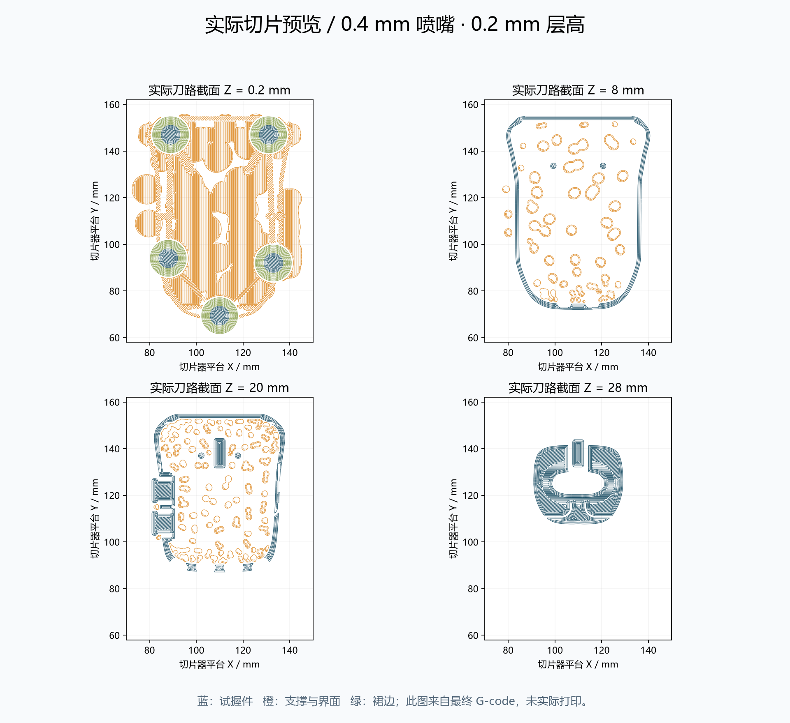

# V0.3 打印、支撑和真实切片估算

## 选择打印文件

- 整体试握：`exports/v03/quietmirror_fingertip_V0.3_FIT.stl`，或已嵌入配置的`quietmirror_fingertip_V0.3_PRINT.3mf`。
- 分体侧键：`quietmirror_fingertip_V0.3_SHELL.stl` + `side_button_1_V0.3_PRINT.stl` + `side_button_2_V0.3_PRINT.stl`。不要把装配STEP直接当一体件打印。
- 所有STL按mm、100%。FIT/SHELL实测61.987 ×90 ×31；键帽打印外接尺寸6.2 ×13.2 ×10.1。

## 朝向与支撑

FIT/SHELL：五个脚贴粘贴面Z0朝下，不要用外壳顶部接触热床。底部大开口便于拆内部支撑，保留五脚和永久底筋。支撑主要在内顶壳、固定轮轴/轮架、侧键导向台、键帽下方和低托边；后壳孔口附近也会生成部分有机支撑。

独立键帽：导出文件已旋转为内侧限位边朝下。外键面悬于导向段上方，有少量挑边，因此本次实际切片仍启用支撑。每件约0.29 g支撑，0.043 g裙边。去支撑时不要削薄1.6 mm限位边。

参数：PrusaSlicer2.9.6，0.4喷嘴，0.2层高/首层，0.45挤出宽，4周壁，20% gyroid，5顶底层，1.75 PLA/密度1.24，210/60℃，外壁25 mm/s，有机支撑仅从热床生成，阈值45°，Z间隙0.2，XY间隙0.35，3层支撑界面，4 mm外裙边。

这是通用估算配置，3MF打开后应选择自己的打印机与材料。未发布G-code，尚未实际打印、去支撑或称重。五脚粘贴面在CAD共面不代表FDM一定没有翘曲；首层毛边需清理，五个圆点脚贴必须同厚。

## 实际切片结果

| 模型 | 本体 g | 支撑 g | 裙边 g | 切片器总量 g | 时间 |
|---|---:|---:|---:|---:|---|
| FIT | 25.586 | 16.116 | 0.173 | 41.87 | 5h13m20s |
| SHELL | 24.415 | 16.063 | 0.173 | 40.65 | 5h03m45s |
| 前键帽 | 0.579 | 0.290 | 0.043 | 0.91 | 10m38s |
| 后键帽 | 0.579 | 0.290 | 0.043 | 0.91 | 10m38s |

分项按实际相对E挤出刀路长度 ×1.75 mm线材截面积 ×1.24密度计算；存在舍入，权威总量取G-code尾部。独立键帽两份分别实际切片，输出相同。分体三件单独打印总计42.47 g；同盘布置后的时间和裙边可能不同。



最终3MF不带`--load`重新切片：41.83 g /5h13m07s，16项关键设置一致；差-0.04 g /-13s。[核对数据](../reports/v03/3mf_roundtrip.json)

## 复现命令

安装官方PrusaSlicer2.9.6后，在项目根目录把下面`$slicer`替换为自己的控制台程序路径：

```powershell
$slicer = 'C:\Program Files\Prusa3D\PrusaSlicer\prusa-slicer-console.exe'
New-Item -ItemType Directory -Force .tools | Out-Null
& $slicer --info exports\v03\quietmirror_fingertip_V0.3_FIT.stl
& $slicer --load slicing\V0.3_PLA_0.4_0.20_ESTIMATE.ini --export-gcode --output .tools\V0.3_estimate_with_support.gcode exports\v03\quietmirror_fingertip_V0.3_FIT.stl
& $slicer --load slicing\V0.3_PLA_0.4_0.20_ESTIMATE.ini --save slicing\V0.3_PLA_0.4_0.20_FULL.ini
& $slicer --load slicing\V0.3_PLA_0.4_0.20_ESTIMATE.ini --center 110,110 --export-3mf --output exports\v03\quietmirror_fingertip_V0.3_PRINT.3mf exports\v03\quietmirror_fingertip_V0.3_FIT.stl
python cad\embed_3mf_profile.py --version 0.3
& $slicer --export-gcode --output .tools\V0.3_3mf_roundtrip.gcode exports\v03\quietmirror_fingertip_V0.3_PRINT.3mf
python cad\check_3mf_roundtrip.py --version 0.3
python cad\analyze_slice.py --version 0.3
```

CLI导出3MF后单独嵌入已保存的完整INI，重切片核对配置确实生效；仅导出一个3MF文件并不能证明它包含支撑/材料设置。

## 后处理与装入侧键

轻修端缘、主键窄缝和六边孔毛刺，不能把永久筋条当支撑剪掉。分体版先清窗口和键帽导向段；从底部中前开口送入内腔，在内侧避开导向台抬高到窗口，再向外插入。名义配合只经过数字模型检查，实际打印可能需要少量去毛刺。FIT版的侧键固定小桥不要剪除，否则键帽会变成没有完整保留结构的松动件；需要分体时直接打印SHELL方案。
