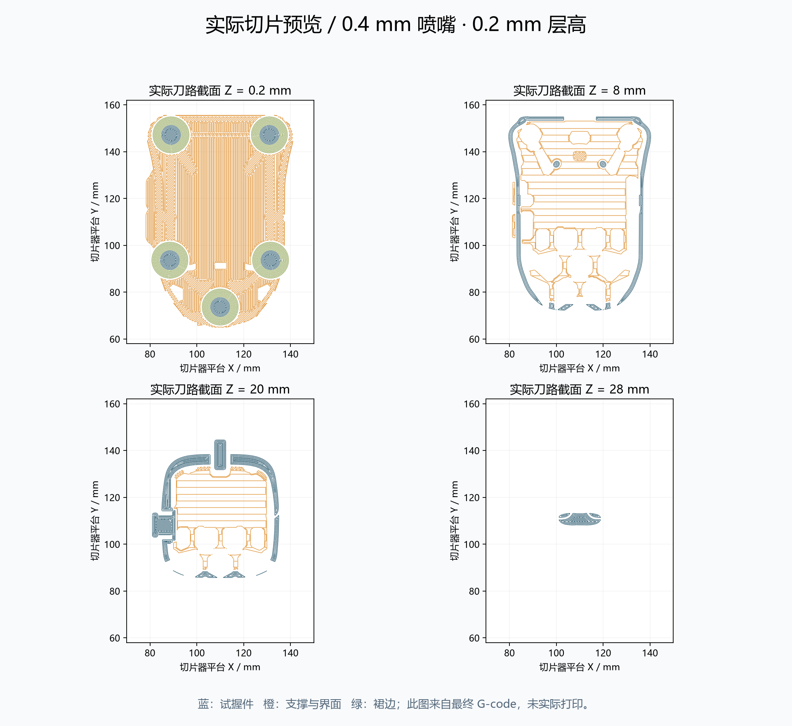

# V0.6 打印说明

打印文件：[FIT STL](../exports/v06/quietmirror_fingertip_V0.6_FIT.stl) 或 [带配置 3MF](../exports/v06/quietmirror_fingertip_V0.6_PRINT.3mf)。电子场景 VIEW_ONLY 不能作为整件打印板。

毫米、100%比例，长×宽×高 90.312×61.970×28.002。五脚底面朝热床，Z=0；不要缩放来套入旧尺寸。切片器的包围盒结果在 [slicer_model_info](../reports/v06/slicer_model_info.txt)。

已用 PrusaSlicer 2.9.6 实际切片：0.4喷嘴、0.20层高、4壁、5顶/底层、20% gyroid、PLA 1.75/1.24 g/cm³、210°C喷嘴/60°C床。支撑采用 snug、仅从热床、45°阈值、Z间隙0.2、XY间隙0.35、3层界面；4 mm brim。打印前改成真实打印机与耗材配置。配置是估算用途，不附未知打印机可直接执行的 G-code。

支撑主要位于主键内侧、滚轮及其支架下、后壳顶面、侧键固定件下和充电口上沿。建议从开放底部与后孔分段移除支撑，不强扭2.2 mm窄筋。避免沿薄边撬动侧键；孔口和接触边缘去毛刺。

本体 21.421 g，支撑 14.994 g，裙边 0.173 g，总耗材 36.59 g，4h 18m 38s。这是切片估计；未实际打印/去支撑/称重。最终3MF无外部INI重切片，总重 36.57 g、4h 18m 31s，16项设置一致，允许重复切片产生的小幅路径差异。

独立侧键文件已摆为限位边朝下；其重量和时间见 [分件切片](../reports/v06/separate_parts_slice.json)。SHELL/独立侧键与FIT是不同选择，不要叠印。SHELL删除固定滚轮与支架，用于继续装配设计，不能把没有支撑的电子示意零件视为已经装牢。
